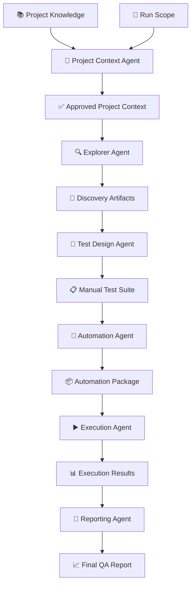
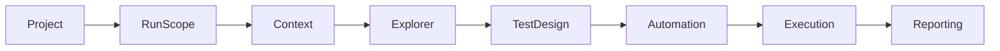
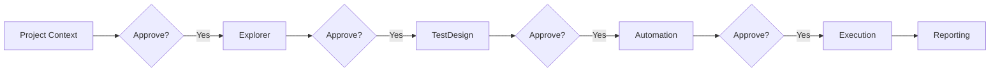
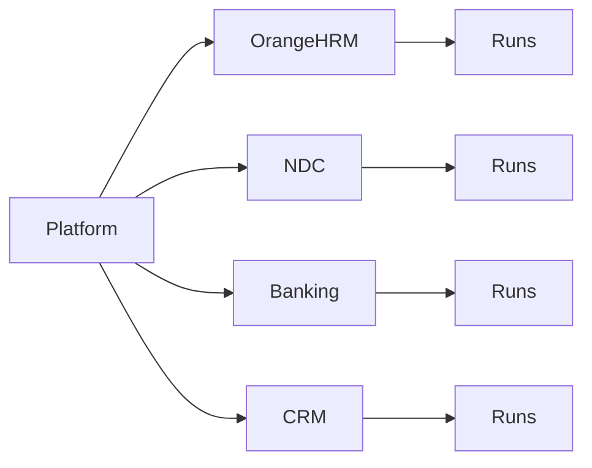
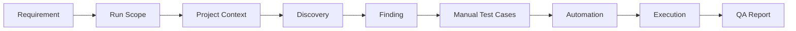

<div align="center">

# 🚀 Agentic AI Testing Platform

### Enterprise-Ready AI-Powered Software Testing Platform

**Explore • Design • Automate • Execute • Report**

<p>


</p>

</div>

---

# 📖 Overview

The **Agentic AI Testing Platform** is an enterprise-ready AI-powered software testing platform that orchestrates specialized AI agents to perform the complete software testing lifecycle.

Unlike traditional automation frameworks, this platform understands project knowledge, explores applications, generates manual test cases, creates automation, executes validations, and produces professional QA reports while keeping humans in control through approval gates.

The platform is designed to be:

- 🤖 Multi-Agent
- 📂 Multi-Project
- 👨 Human Governed
- 📈 Traceability Driven
- 🧩 Modular
- 🚀 Enterprise Ready

---

# 🎯 Vision

Build an AI-powered testing platform capable of understanding software projects, exploring applications, designing manual tests, generating maintainable automation, executing validations, and producing enterprise-grade QA reports.

---

# ✨ Why This Platform?

Traditional automation frameworks focus only on automation.

This platform manages the **entire QA lifecycle**.

| Traditional Framework | Agentic AI Testing Platform |
|----------------------|-----------------------------|
| Automation Only | Complete QA Lifecycle |
| Single Script | Multiple Specialized AI Agents |
| Manual Context | AI-Generated Project Context |
| No Traceability | End-to-End Traceability |
| Single Project | Multi-Project |
| Static | Run Scope Driven |
| Limited Reporting | Professional QA Reports |

---

# ⭐ Core Features

- 🤖 Multi-Agent Architecture
- 📂 Multi-Project Support
- 🎯 Run Scope
- 📚 Project Knowledge Management
- 🔍 Intelligent Application Exploration
- 📝 Manual Test Design
- 🤖 Automation Generation
- ▶️ Automated Execution
- 📊 QA Reporting
- 🔗 End-to-End Traceability
- 👨 Human Approval Gates
- 📦 Versioned Runs
- 🧩 Reusable Project Templates

---
# 🏗 Platform Architecture

The platform is built around specialized AI agents, each responsible for a single stage of the QA lifecycle.



---

# 🔄 End-to-End Workflow

Every execution follows the same approved workflow.



---

# 🤖 AI Agents

Each agent has a single responsibility and communicates only through approved artifacts.

| Agent | Responsibility |
|--------|----------------|
| 🧠 Project Context Agent | Builds the operational Project Context from Project Knowledge and Run Scope |
| 🔍 Explorer Agent | Explores the application and discovers findings |
| 📝 Test Design Agent | Generates manual test suites and traceability |
| 🤖 Automation Agent | Generates maintainable automation packages |
| ▶️ Execution Agent | Executes automation and collects execution evidence |
| 📊 Reporting Agent | Produces the final QA assessment report |

---

# 🛡 Human Approval Gates

The platform keeps humans in control of critical decisions.



Nothing crosses an approval boundary automatically.

Every critical stage requires explicit human approval before proceeding.

---
# 📂 Repository Structure

The platform is organized to clearly separate reusable platform components, project knowledge, and generated artifacts.

```text
agentic-ai-testing-platform/

├── agents/
│   ├── project_context_agent.md
│   ├── explorer_agent.md
│   ├── test_design_agent.md
│   ├── automation_agent.md
│   ├── execution_agent.md
│   └── reporting_agent.md
│
├── pipeline/
│   ├── pipeline.md
│   ├── run_manager.md
│   └── run_scope.md
│
├── projects/
│   ├── README.md
│   ├── OrangeHRM/
<<<<<<< HEAD
│   │   └── artifacts/          (generated outputs — self-contained per project, no root-level artifacts/)
│   ├── NDC/
│   │   └── artifacts/
│   └── templates/
│       └── project_template/
│           └── artifacts/      (empty skeleton, per pipeline/run_manager.md §6)
=======
│   └── templates/
│       └── project_template/
│
├── artifacts/
>>>>>>> main
│
├── workflows/
│
├── prompts/
│
├── docs/
│
├── README.md
├── VISION.md
├── LESSONS_LEARNED.md
└── PLATFORM_VALIDATION_REPORT.md
```

---

# 📁 Multi-Project Architecture

The platform is designed to support multiple applications using the same testing pipeline.



Each project is completely independent and maintains its own:

- Project Knowledge
- Run Configuration
- Resources
- Generated Artifacts
- Execution History

---

# 📚 Project Knowledge

Every application onboarded into the platform has its own knowledge base.

```text
projects/

└── OrangeHRM/
<<<<<<< HEAD
    ├── PRD.md
=======
>>>>>>> main
    ├── onboarding.md
    ├── architecture.md
    ├── glossary.md
    ├── run_configuration.md
<<<<<<< HEAD
    ├── resources/
    └── artifacts/          (generated outputs live here — see below)
=======
    └── resources/
>>>>>>> main
```

Project Knowledge represents the permanent understanding of an application.

It is maintained by engineers and evolves with the product.

---

# 📦 Generated Artifacts

<<<<<<< HEAD
Generated outputs never modify the original project knowledge. As of the repository's v1.0 architecture, every project is **fully self-contained** — generated artifacts live *inside* the project's own folder, under `projects/{{PROJECT_NAME}}/artifacts/`. There is no repository-root `artifacts/` directory.

```text
projects/

└── OrangeHRM/

    ├── PRD.md              # Project Knowledge — a Stage 1 input, not a generated artifact

    └── artifacts/          # pipeline-stage outputs only — nothing here duplicates project knowledge

        ├── context/
        ├── discovery/
        ├── test_design/
        ├── automation/
        ├── execution/
        ├── reporting/
        ├── pipeline/       # Run Manifest — approval/checkpoint state only

        └── runs/

            ├── RUN-001/
            ├── RUN-002/
            └── RUN-003/
=======
Generated outputs never modify the original project knowledge.

```text
artifacts/

└── OrangeHRM/

    ├── context/

    ├── runs/

    │   ├── RUN-001/

    │   ├── RUN-002/

    │   └── RUN-003/
>>>>>>> main
```

Each run is fully isolated and versioned.

Generated artifacts include:

- Project Context
- Discovery Artifacts
- Findings
- Manual Test Suites
- Automation Packages
- Execution Results
- Final QA Reports

---

# ⚖️ Project Knowledge vs Project Context

One of the most important architectural concepts in the platform.

| Project Knowledge | Project Context |
|-------------------|-----------------|
| Permanent | Generated Per Run |
| Maintained by Engineers | Generated by AI |
<<<<<<< HEAD
| Lives under `projects/{{PROJECT_NAME}}/` (excluding `artifacts/`) | Lives under `projects/{{PROJECT_NAME}}/artifacts/` |
=======
| Lives under `projects/` | Lives under `artifacts/` |
>>>>>>> main
| Contains everything about the application | Contains only what is required for the current run |
| Changes rarely | Generated for every execution |

Project Knowledge is the **Canonical Source of Truth**.

Project Context is the **Operational Source of Truth** for a single run.

---

# 🎯 Run Scope

Every execution starts with a Run Scope.

Supported Run Scopes:

- Entire Project
- Epic
- Feature
- User Story
- Bug
- Requirement Document
- Custom Scope

Run Scope determines exactly what the current execution is allowed to validate.

Future integrations include:

- Azure DevOps
- Jira
- Xray
- TestRail

---
# 🔗 End-to-End Traceability

One of the platform's core principles is maintaining complete traceability throughout the QA lifecycle.



Every generated artifact can be traced back to its originating requirement or scope.

---

# 📊 Generated Deliverables

The platform automatically produces a comprehensive set of artifacts during each run.

| Stage | Generated Deliverables |
|--------|------------------------|
| Project Context | Approved Project Context |
| Explorer | Discovery Report, Findings, Evidence |
| Test Design | Manual Test Suite, Traceability Matrix, Coverage Report |
| Automation | Automation Package, Automation Manifest, Decision Report |
| Execution | Execution Results, Screenshots, Videos, Traces |
| Reporting | Final QA Report |

---

# 🛡 Human Approval Philosophy

The platform is **AI-Assisted**, not AI-Autonomous.

Critical decisions always require human approval.

Approval checkpoints exist before:

- ✅ Project Context
- ✅ QA Assessment
- ✅ Automation Generation
- ✅ Test Execution (optional execution configuration)

This ensures engineers remain in full control of the testing lifecycle.

---

# 🧪 Supported Frameworks

### Currently Supported

| Framework | Status |
|------------|--------|
| Playwright | ✅ |
| SHAFT Engine | ✅ |

### Planned

| Framework | Status |
|------------|--------|
| Selenium | 🚧 |
| Cypress | 🚧 |

---

# 🚀 Quick Start

Clone the repository.

```bash
<<<<<<< HEAD
git clone https://github.com/<your-account>/agentic-ai-testing-platform.git
=======
git clone https://github.com/ayman2911/agentic-ai-testing-platform.git
>>>>>>> main

cd agentic-ai-testing-platform
```

## Create a New Project

```text
projects/

└── MyProject/
```

Populate the project knowledge.

Configure the Run Scope.

Generate the Project Context.

Approve the generated context.

Run the platform pipeline.

Review the generated QA Report.

---

# 📚 Documentation

| Document | Description |
|----------|-------------|
| README.md | Platform Overview |
| VISION.md | Long-Term Vision |
| LESSONS_LEARNED.md | Architecture Decisions |
| PLATFORM_VALIDATION_REPORT.md | End-to-End Validation |
| agents/ | Agent Specifications |
| pipeline/ | Pipeline Architecture |
| projects/ | Project Knowledge |
| workflows/ | Execution Workflows |

---

# 🗺 Roadmap

## ✅ Version 1.0

- Multi-Agent Architecture
- Multi-Project Support
- Project Knowledge
- Run Scope
- End-to-End Validation
- Playwright Support
- SHAFT Engine Support
- Human Approval Gates
- Versioned Runs

---

## 🚧 Version 1.1

- Project Bootstrap Wizard
- Azure DevOps Integration
- Jira Integration
- Story-Based Execution
- HTML Dashboard
- Rich Reporting

---

## 🚀 Version 2.0

- AI QA Engineer
- Self-Healing Automation
- Autonomous Test Planning
- Smart Selector Recovery
- Enterprise Dashboard

---

# 🤝 Contributing

Contributions are welcome.

Please follow these guidelines:

- Preserve the platform architecture.
- Keep agents single-responsibility.
- Maintain end-to-end traceability.
- Never bypass approval gates.
- Update documentation when introducing architectural changes.
- Prefer reuse over duplication.
<<<<<<< HEAD

=======
>>>>>>> main
---

