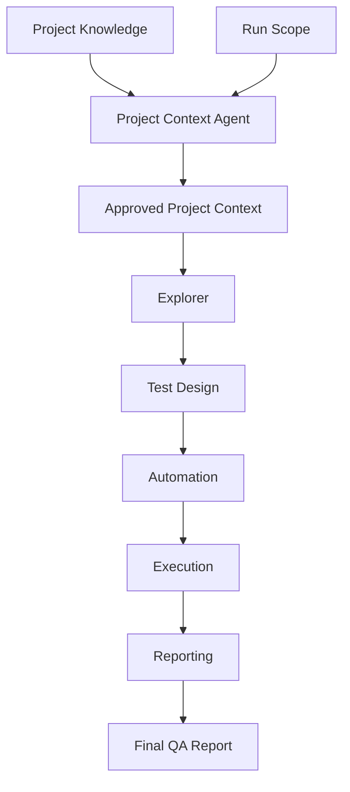
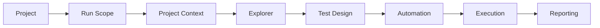
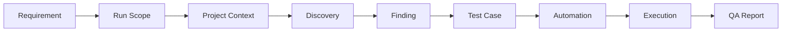

# 🚀 Agentic AI Testing Platform

> Enterprise-ready AI-powered software testing platform built around specialized AI agents.

## Overview

The Agentic AI Testing Platform orchestrates specialized AI agents to perform the complete software testing lifecycle while keeping humans in control through approval gates.

## 🏗 Platform Architecture



## 🔄 Workflow



## 🤖 AI Agents

| Agent | Responsibility |
|---|---|
| Project Context | Builds the operational project context |
| Explorer | Explores the application |
| Test Design | Generates manual test suites |
| Automation | Generates automation assets |
| Execution | Executes automation |
| Reporting | Produces QA reports |

## 📂 Repository Structure

```text
agentic-ai-testing-platform/
├── agents/
├── pipeline/
├── projects/
├── artifacts/
├── workflows/
├── prompts/
├── docs/
└── README.md
```

## 📁 Projects

`projects/` contains canonical project knowledge.

## 📦 Artifacts

`artifacts/` contains generated outputs for each run.

## 🎯 Run Scope

Supported:
- Entire Project
- Epic
- Feature
- User Story
- Bug
- Requirement
- Custom

Future:
- Azure DevOps
- Jira
- Xray
- TestRail

## 🔗 Traceability



## 🧪 Frameworks

Current:
- Playwright
- SHAFT Engine

Planned:
- Selenium
- Cypress

## 🚀 Quick Start

```bash
git clone <repository>
cd agentic-ai-testing-platform
```

1. Create a project under `projects/`
2. Define the Run Scope
3. Generate the Project Context
4. Review and approve
5. Execute the pipeline

## 🗺 Roadmap

### v1.0
- Multi-Agent Platform
- Multi-Project Support
- Run Scope

### v1.1
- Project Bootstrap Wizard
- Azure DevOps
- Jira

### v2.0
- AI QA Engineer
- Self-Healing Automation
