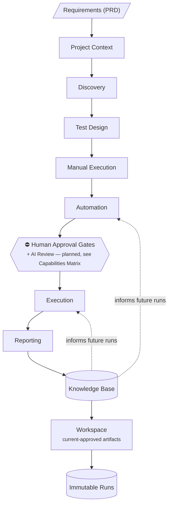
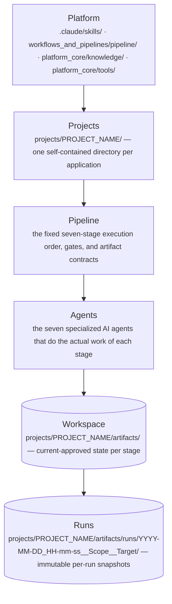
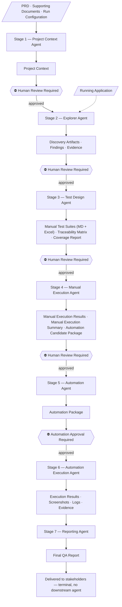
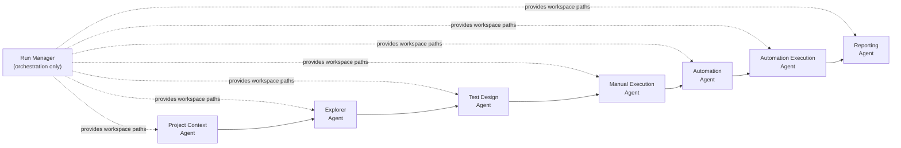
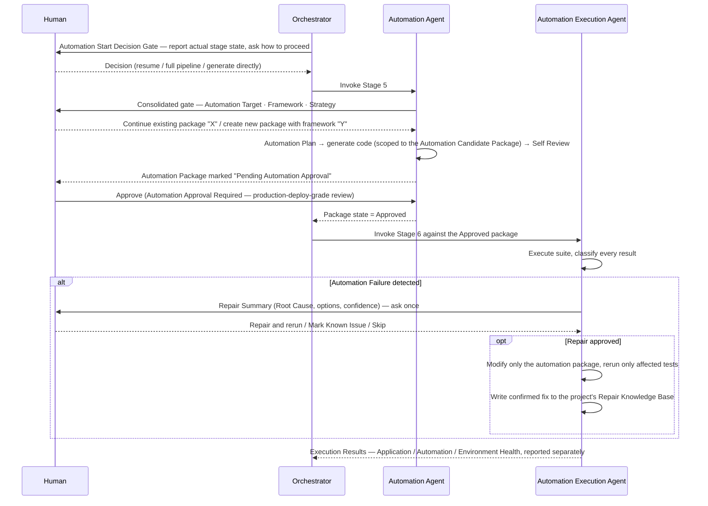
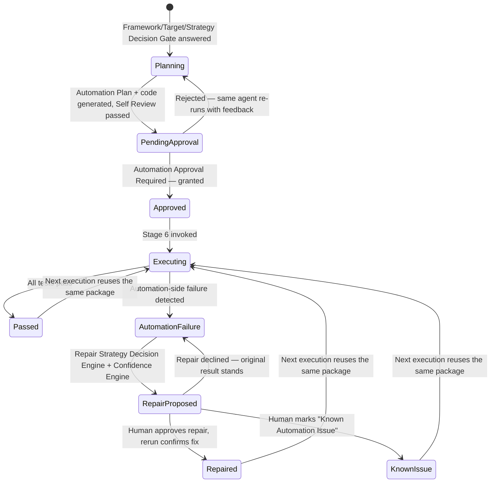
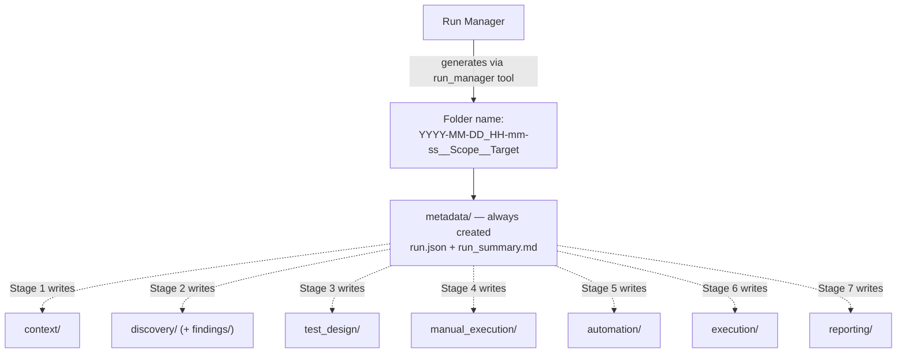
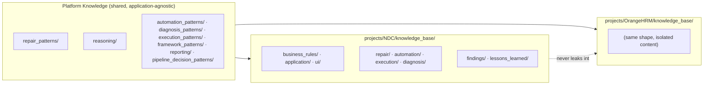
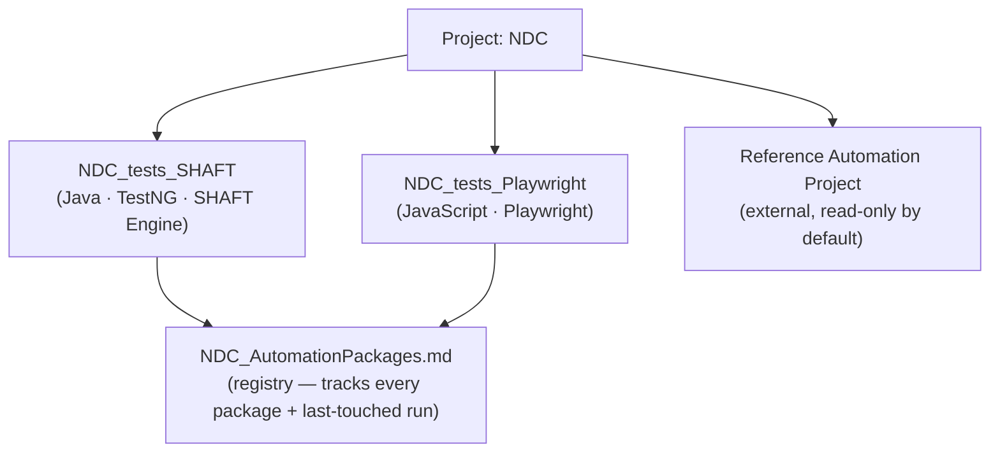

# Agentic AI Testing Platform

**Explore · Design · Validate · Automate · Execute · Report**

[](docs/CHANGELOG.md)
[](#7-agent-architecture)
[](#13-design-principles)
[](projects/README.md)
[](#6-pipeline-architecture)
[](#1-project-overview)
[](#11-knowledge-base)
[](#6-pipeline-architecture)
[](#18-documentation-map)

The Agentic AI Testing Platform is a multi-agent system that runs the complete software QA lifecycle — from an approved requirement to a delivered Final QA Report — as one governed, traceable pipeline. It exists to close the gap between conventional test automation tooling, which assumes test cases already exist, and the much larger problem most QA teams actually face: understanding an application, designing the right tests, generating automation that stays maintainable, and trusting the results enough to act on them. It's built for QA leads, test architects, and automation engineers who need enterprise-grade traceability and governance across many applications at once — not simply a faster way to write scripts.

Where a traditional automation framework turns a fixed set of test cases into runnable code, this platform treats automation as one stage in a longer, artifact-driven chain: specialized AI agents explore the application, design test cases, generate automation, execute it, and report results, handing off a versioned artifact at every step. Every step that carries real risk — a document about to govern downstream work, code about to execute against a real environment — stops for explicit human approval. The result is a platform designed to get more reliable over time, not just faster: confirmed repairs and reusable engineering knowledge are captured once and applied automatically the next time a similar failure occurs, across every project it manages.

---

## Vision

The long-term vision is an enterprise QA function where AI agents carry out the mechanical work — exploration, test design, automation, execution — while humans retain every decision that carries real business or technical risk. Automation quality should compound through a shared Knowledge Base instead of being rebuilt from scratch on every project, and every one of those capabilities should stay fully auditable, one traceable artifact at a time. This is the direction the architecture is built toward — see [Current Project Status](#current-project-status) below for exactly how much of it is implemented today versus still in progress.

---

## Why This Platform

| Traditional Automation Framework | Agentic AI Testing Platform |
|---|---|
| Automation only | Complete QA lifecycle |
| Single script / suite | Multi-agent architecture |
| Manual context gathering | AI-generated Project Context |
| No traceability | Requirement-to-result traceability |
| Single project | Multi-project, isolated by design |
| Framework-centric | Knowledge-centric |
| Manual maintenance | Repair Knowledge Base |
| Static reports | Professional QA reports |

---

## Core Features

| | | |
|---|---|---|
| Multi-Agent Architecture | Multi-Project Support | Project Context |
| Run Scope | Knowledge Base | AI-Driven Discovery |
| Test Design | Automation Generation | Execution |
| Reporting | Repair Knowledge Base | Human Approval Workflow |
| Multi-Framework Support | | |

*Explained in full, with specifications, in the sections below.*

---

## Platform Highlights

| | |
|---|---|
| ✅ Enterprise Architecture | ✅ Knowledge Driven |
| ✅ Human Governed | ✅ Multi-Framework |
| ✅ Modular Design | ✅ End-to-End Traceability |
| ✅ Immutable Runs | ✅ AI Assisted |

---

## Current Project Status

| Area | Status |
|---|---|
| Repository Architecture | ✅ Stable |
| Documentation | ✅ Comprehensive |
| Platform Design (Agents, Pipeline, Knowledge Architecture) | ✅ Stable |
| Reference Project Validation (NDC) | ✅ Executed |
| Cross-Project Rollout (beyond NDC / OrangeHRM) | 🚧 In Progress |
| Deterministic Tooling Layer (beyond the Browser Driver) | 🚧 In Progress |
| Enterprise Integrations (ALM, Dashboards) | 📅 Planned |

*Status reflects platform specification and reference-project validation, not a hosted or packaged product release. See [§4 Platform Capabilities Matrix](#4-platform-capabilities-matrix) for a capability-by-capability breakdown.*

---

## Quick Navigation

[Overview](#1-project-overview) · [Architecture](#5-high-level-architecture) · [Pipeline](#6-pipeline-architecture) · [Agents](#7-agent-architecture) · [Repository](#9-repository-structure) · [Knowledge Base](#11-knowledge-base) · [Run Management](#10-run-architecture) · [Getting Started](#17-getting-started) · [Roadmap](#19-future-roadmap)

The sections below are the platform's complete technical documentation — architecture, pipeline, agents, and full operational detail.

---

## Table of Contents

1. [Project Overview](#1-project-overview)
2. [Key Features](#2-key-features)
3. [End-to-End Platform Overview](#3-end-to-end-platform-overview)
4. [Platform Capabilities Matrix](#4-platform-capabilities-matrix)
5. [High-Level Architecture](#5-high-level-architecture)
6. [Pipeline Architecture](#6-pipeline-architecture)
7. [Agent Architecture](#7-agent-architecture)
8. [Automation Package Lifecycle](#8-automation-package-lifecycle)
9. [Repository Structure](#9-repository-structure)
10. [Run Architecture](#10-run-architecture)
11. [Knowledge Base](#11-knowledge-base)
12. [Multi-Framework Architecture](#12-multi-framework-architecture)
13. [Design Principles](#13-design-principles)
14. [Architecture Decision Records](#14-architecture-decision-records)
15. [Technology Stack](#15-technology-stack)
16. [Quick Start](#16-quick-start)
17. [Getting Started](#17-getting-started)
18. [Documentation Map](#18-documentation-map)
19. [Future Roadmap](#19-future-roadmap)

---

## 1. Project Overview

Most automation frameworks solve one problem: turning a known set of test cases into runnable scripts. They assume the requirements are already understood, the test cases are already written, and a human will read the results.

The Agentic AI Testing Platform is built around a different premise: the entire QA lifecycle — from "what does this application need to do" through "did it actually do it" — can be modeled as a chain of specialized AI agents that each own exactly one stage of that lifecycle, hand off their work through versioned artifacts, and stop at defined checkpoints for a human to approve before anything downstream depends on it.

Concretely, the platform:

- Turns an approved requirements document (PRD) into a scoped **Project Context** for a specific run.
- **Explores** the live application (or falls back to documentation, recordings, or user-guided exploration when a live app isn't available) and produces evidence-backed Discovery Artifacts.
- **Designs** manual test cases and a full requirement-traceability matrix from that context.
- **Generates** maintainable automation — reusing existing automation before writing new code, and supporting multiple frameworks side by side.
- **Executes** that automation, separating failures caused by the application, the automation, or the environment.
- **Reports** a QA assessment that a stakeholder can act on, with every claim traceable back to a requirement.

### Business value

- **Traceability by construction.** Every test case, automation script, and execution result carries a citation back to the requirement it covers — not because someone remembered to fill in a spreadsheet column, but because the pipeline's artifact contracts require it.
- **Governed, not autonomous.** The platform is AI-*assisted*. Every stage that produces a document or authorizes code execution stops at a named checkpoint until a human with the right role signs off — see §5.5 of [`workflows_and_pipelines/pipeline/pipeline.md`](workflows_and_pipelines/pipeline/pipeline.md) for exactly which decisions are reserved for a human versus made automatically.
- **Compounding, not repeating.** Repair strategies that are confirmed to work are captured in a versioned Knowledge Base and reused on the next failure with the same signature — instead of every run re-diagnosing the same class of problem from zero.
- **Multi-project by design.** Each onboarded application is fully self-contained under its own `projects/{{PROJECT_NAME}}/` directory, so the same seven agents and one pipeline specification scale to dozens of unrelated applications without per-project code changes.

### Philosophy of AI-assisted testing

The platform is built on one recurring architectural pattern, repeated at every layer: **separate defining from validating, and separate producing from judging.**

- Requirements are *defined* in the PRD and *validated* (never redefined) by the Explorer Agent against the live application — a documented discrepancy is a **Gap**, resolved by a human, never silently overwritten by what the agent observed ([Lessons Learned §1](docs/LESSONS_LEARNED.md)).
- Test results are *produced* mechanically by the Automation Execution Agent and *judged* separately by the Reporting Agent — no single agent both runs a test and writes the narrative conclusion about it ([Lessons Learned §2](docs/LESSONS_LEARNED.md)).
- Every gate that can accept a wrong *document* (Stages 1–4) is deliberately weaker than the gate that authorizes *code to execute* against a real environment (Stage 5) — because the blast radius of the two failure modes is not the same ([Lessons Learned §3](docs/LESSONS_LEARNED.md)).

This is why the platform reads as "a pipeline with agents inside it," not "an agent with tools attached" — the discipline lives in the artifact contracts and checkpoints between stages, not in any single agent's judgment.

---

## 2. Key Features

| Feature | What it does | Where it's specified |
|---|---|---|
| **AI-Driven Discovery** | Explores a live application (or falls back through screenshots, recordings, user-guided exploration, documentation, or APIs) and produces evidence-backed findings, never inventing requirements | [`.claude/skills/explorer-agent/SKILL.md`](.claude/skills/explorer-agent/SKILL.md) |
| **Test Design Generation** | Derives manual test cases and a full traceability matrix from the approved Project Context, using Discovery only to validate/enrich | [`.claude/skills/test-design-agent/SKILL.md`](.claude/skills/test-design-agent/SKILL.md) |
| **Manual Execution & Automation Candidate Identification** | Executes the approved manual test suite against the live application, records raw results with evidence, and identifies only the successfully, stably executed test cases as candidates for automation | [`.claude/skills/manual-execution-agent/SKILL.md`](.claude/skills/manual-execution-agent/SKILL.md) |
| **Automation Generation** | Produces a production-quality, maintainable automation project — never a bag of isolated scripts — reusing existing automation first, scoped to the Manual Execution Agent's confirmed Automation Candidates | [`.claude/skills/automation-agent/SKILL.md`](.claude/skills/automation-agent/SKILL.md) |
| **Multi-Package, Multi-Framework Automation** | A project can hold several independent Automation Packages side by side (e.g. SHAFT and Playwright for the same application), each tracked in its own registry entry | [§8](#8-automation-package-lifecycle), [§12](#12-multi-framework-architecture) |
| **Automation Repair Loop + Confidence Engine** | Diagnoses automation-side failures, proposes evidence-derived repair strategies with a percentage confidence, reruns only what was repaired, and separates Application/Automation/Environment health | [`.claude/skills/automation-execution-agent/SKILL.md` §25–§28](.claude/skills/automation-execution-agent/SKILL.md) |
| **Two-Layer Knowledge Architecture** | Reusable engineering knowledge (Platform Knowledge) is kept separate from application-specific knowledge (Project Knowledge), merged automatically, promoted only by explicit human approval | [§11](#11-knowledge-base), [`workflows_and_pipelines/pipeline/pipeline.md` §10](workflows_and_pipelines/pipeline/pipeline.md) |
| **Human Approval Workflow** | Two distinct gate types — "Human Review Required" for documents, "Automation Approval Required" for code about to execute — plus an explicit Human-vs-Engineering decision boundary so approval isn't requested for routine engineering calls | [`workflows_and_pipelines/pipeline/pipeline.md` §5](workflows_and_pipelines/pipeline/pipeline.md) |
| **Self-Descriptive Run Management** | Every execution gets a deterministic, self-descriptive folder name (`YYYY-MM-DD_HH-mm-ss__Scope__Target`), generated by a single reusable utility, an on-demand-built workspace, structured metadata, and a factual run summary — with no judgment role of its own | [`workflows_and_pipelines/pipeline/run_manager.md`](workflows_and_pipelines/pipeline/run_manager.md) |
| **Run Scope** | Every run declares exactly what it's allowed to validate — Entire Project, Epic, Feature, User Story, Bug, Requirement Document, or Custom Scope | [`workflows_and_pipelines/pipeline/run_scope.md`](workflows_and_pipelines/pipeline/run_scope.md) |
| **Reference Automation Project Support** | A project can register an external, human-owned automation codebase as a reference — read-only by default, with an explicit gate before any write to it | [`.claude/skills/automation-agent/SKILL.md` §32](.claude/skills/automation-agent/SKILL.md) |
| **Browser Driver Layer** | A single shared engine (`platform_core/tools/browser_driver/`) drives authenticated browser sessions for every project, with credentials always outside the repo's tracked history | [`platform_core/tools/browser_driver/README.md`](platform_core/tools/browser_driver/README.md) |
| **Reporting** | A Final QA Report that computes Requirement Coverage and Automation Coverage by walking the full traceability chain, not by re-asserting the Automation Execution Agent's raw output | [`.claude/skills/reporting-agent/SKILL.md`](.claude/skills/reporting-agent/SKILL.md) |
| **Execution Analysis** | Application Health, Automation Health, and Environment Health are always reported as three separate figures — never one merged "Failed" count | [`.claude/skills/automation-execution-agent/SKILL.md` §25.6](.claude/skills/automation-execution-agent/SKILL.md) |

---

## 3. End-to-End Platform Overview

The entire platform, at a glance — read top to bottom:



A **Requirement** becomes a scoped **Project Context**, which drives **Discovery** of the real application, which grounds **Test Design**, which drives **Manual Execution** — validating the designed test cases against the live application and identifying which are stable enough to automate — which drives **Automation**. Nothing generated automation executes without clearing a **Human Approval Gate** first. **Execution** produces raw results, **Reporting** turns them into a stakeholder-facing QA assessment, and every confirmed repair or lesson feeds the **Knowledge Base** — which in turn informs the *next* run's Automation and Execution stages, rather than starting from zero. The **Workspace** holds each stage's current-approved output; every run that ever touched it is preserved forever as an **Immutable Run**.

This is the same flow detailed stage-by-stage in [§6 Pipeline Architecture](#6-pipeline-architecture) — this diagram exists so a new engineer can hold the whole system in their head before reading any further.

---

## 4. Platform Capabilities Matrix

A capability listed here as *Implemented* has a written agent/pipeline specification **and** has been exercised on a real onboarded project (evidence: NDC's executed runs, generated automation packages, and Repair Knowledge Base entries). *Designed* means a specification exists but no project has exercised it yet. *Planned* means it is a named direction with no implementation specification yet — see [§19 Future Roadmap](#19-future-roadmap).

| Capability | Status | Notes |
|---|---|---|
| Discovery (browser automation + documented fallback chain) | ✅ Implemented | [`.claude/skills/explorer-agent/SKILL.md`](.claude/skills/explorer-agent/SKILL.md) |
| Test Design Generation | ✅ Implemented | [`.claude/skills/test-design-agent/SKILL.md`](.claude/skills/test-design-agent/SKILL.md) |
| Manual Execution & Automation Candidate Identification | ✅ Implemented | [`.claude/skills/manual-execution-agent/SKILL.md`](.claude/skills/manual-execution-agent/SKILL.md) |
| Automation Generation (multi-framework, multi-package) | ✅ Implemented | [`.claude/skills/automation-agent/SKILL.md`](.claude/skills/automation-agent/SKILL.md) |
| Execution | ✅ Implemented | [`.claude/skills/automation-execution-agent/SKILL.md`](.claude/skills/automation-execution-agent/SKILL.md) |
| Reporting | ✅ Implemented | [`.claude/skills/reporting-agent/SKILL.md`](.claude/skills/reporting-agent/SKILL.md) |
| Human Approval Workflow (two gate types) | ✅ Implemented | [`workflows_and_pipelines/pipeline/pipeline.md` §5](workflows_and_pipelines/pipeline/pipeline.md) |
| Automation Package Lifecycle (registry, decision gates, repair states) | ✅ Implemented | [§8](#8-automation-package-lifecycle) |
| Automation Repair Loop + Confidence Engine | ✅ Implemented | [`.claude/skills/automation-execution-agent/SKILL.md` §25–§28](.claude/skills/automation-execution-agent/SKILL.md) |
| Two-Layer Knowledge Architecture | ✅ Implemented | [§11](#11-knowledge-base) |
| Intelligent Run Management | ✅ Implemented | [`workflows_and_pipelines/pipeline/run_manager.md`](workflows_and_pipelines/pipeline/run_manager.md) |
| Reference Automation Project support | ✅ Implemented | [`.claude/skills/automation-agent/SKILL.md` §32](.claude/skills/automation-agent/SKILL.md) |
| Browser Driver Layer | ✅ Implemented | [`platform_core/tools/browser_driver/README.md`](platform_core/tools/browser_driver/README.md) |
| Multi-Framework Support — SHAFT + Playwright, side by side | ✅ Implemented | [§12](#12-multi-framework-architecture) |
| Additional Frameworks — Selenium / Cypress / Appium / REST Assured | 🚧 Designed | Already named as first-class options in the Framework Decision Gate; no project has selected one yet |
| Non-Web Automation — API / Mobile / Desktop / Microservices / Batch / Cloud | 🚧 Designed | [`.claude/skills/automation-agent/SKILL.md` §29](.claude/skills/automation-agent/SKILL.md) — abstractions extend without redesign, not yet exercised for a real target |
| AI Review (dedicated automated code-review pass) | 📅 Planned | Distinct from today's implemented Automation Agent Self Review; see Future Roadmap |
| Self-Healing Automation (autonomous repair) | 📅 Planned | Extends today's human-gated Repair Loop |
| Video → Automation | 📅 Planned | |
| Regression Intelligence / Impact Analysis | 📅 Planned | |
| ALM Integration — Azure DevOps / Jira / TestRail / Xray | 📅 Planned | [`workflows_and_pipelines/pipeline/run_scope.md`](workflows_and_pipelines/pipeline/run_scope.md) already names these as future Run Scope Sources |
| Enterprise Dashboard / Cross-Project Run Index | 📅 Planned | |

---

## 5. High-Level Architecture

The platform is organized as five concentric layers. Reusable engineering logic lives at the top; a single project's history of runs lives at the bottom.



Reading this top to bottom: the **Platform** defines reusable rules that never change per application. Each **Project** applies those rules to one real application. The **Pipeline** is the fixed sequence those rules run in. The **Agents** are the workers that actually execute each stage. The **Workspace** is where each stage's current-approved output lives (cylinder = data store, consistent with [§3](#3-end-to-end-platform-overview) and [§11](#11-knowledge-base)). **Runs** are the immutable, timestamped history of every time the pipeline (or part of it) was executed.

---

## 6. Pipeline Architecture

Seven agents run in a fixed order. Each stage consumes only artifacts explicitly declared as its input — never a peer stage's internal reasoning — and every checkpoint stops the pipeline until a human with the right role approves.



### Stage summary

| Stage | Agent | Input | Output | Checkpoint |
|---|---|---|---|---|
| 1 | Project Context Agent | PRD, Supporting Documents, Run Configuration | Project Context | Human Review Required |
| 2 | Explorer Agent | Project Context, Running Application | Discovery Artifacts, Findings, Evidence | Human Review Required |
| 3 | Test Design Agent | Project Context (primary), Discovery Artifacts (secondary) | Manual Test Suites, Traceability Matrix, Coverage Report | Human Review Required |
| 4 | Manual Execution Agent | Approved Manual Test Suites, Traceability Matrix, Coverage Report, Project Context | Manual Execution Results, Manual Execution Summary, Automation Candidate Package | Human Review Required |
| 5 | Automation Agent | Approved Automation Candidate Package, Manual Test Suites (content source), Project Context | Automation Package | Automation Approval Required |
| 6 | Automation Execution Agent | Automation Package | Execution Results, Evidence, Metadata | None — mechanical run, already gated by Stage 5 |
| 7 | Reporting Agent | Execution Results, Traceability Matrix, Project Context | Final QA Report | None — terminal stage |

Full specification, including every rule governing gate mechanics and rejection handling: [`workflows_and_pipelines/pipeline/pipeline.md`](workflows_and_pipelines/pipeline/pipeline.md).

### Why two gate types, not one

Approving a document (Stages 1–4) risks a wrong document reaching the next stage. Approving Stage 5 authorizes **generated code to execute against a real environment** — a materially larger blast radius (data mutation, destructive actions, credential use). The pipeline treats "Automation Approval Required" as at least as strict as a production deployment approval, never as a lighter variant of document review.

### Only Stage 1 reads the PRD

No other stage's input list contains the PRD. Once Stage 1's Project Context is approved, every downstream stage treats it — not the original requirements document — as the single source of truth for "what should the product do."

### Human decisions vs. engineering decisions

Not every judgment call inside a stage requires stopping to ask. The pipeline draws this line explicitly ([`workflows_and_pipelines/pipeline/pipeline.md` §5.5](workflows_and_pipelines/pipeline/pipeline.md)):

- **Always ask a human:** which automation framework to use, whether to continue an existing package or start a new one, which project/repository to target, environment selection when more than one exists, any destructive or irreversible operation, and any change to the run's actual business objective.
- **Make the call and keep moving, never pause to ask:** adding security/boundary/negative test cases during test design, marking a scenario `Deferred` when the current environment can't safely run it, risk annotations and coverage-gap documentation, and whether an adjacent unrequested feature stays out of the current run's scope.

---

## 7. Agent Architecture

Each of the seven agents has exactly one responsibility and communicates with its neighbors only through the artifacts defined in [§6](#6-pipeline-architecture). The **Run Manager** sits outside this pipeline entirely — it is orchestration tooling, never a judgment-making agent.

| Component | Responsibility | Never does |
|---|---|---|
| [Run Manager](workflows_and_pipelines/pipeline/run_manager.md) | Allocates a Run ID, prepares the run workspace, tracks mechanical status, publishes a factual run summary | Analyze application behavior, generate a Finding/test case/script, judge whether a run "succeeded" in a quality sense |
| [Project Context Agent](.claude/skills/project-context-agent/SKILL.md) | Builds the scoped, approved Project Context from Project Knowledge + Run Scope — the only stage permitted to read the PRD | Re-consult the PRD once its own output is approved |
| [Explorer Agent](.claude/skills/explorer-agent/SKILL.md) | Explores the application (browser automation, or a documented fallback chain) and produces evidence-backed Discovery Artifacts and Findings | Author or redefine requirements — a live/documented disagreement is logged as a Gap, never silently resolved in the agent's favor |
| [Test Design Agent](.claude/skills/test-design-agent/SKILL.md) | Derives manual test cases and full traceability from the Project Context, using Discovery only to validate, enrich, and surface gaps | Treat Discovery Artifacts as a requirements source |
| [Manual Execution Agent](.claude/skills/manual-execution-agent/SKILL.md) | Executes the approved manual test suite against the live application, records raw results and evidence, and identifies only successfully, stably executed test cases as Automation Candidates | Write or execute automation code, or decide what ultimately gets automated |
| [Automation Agent](.claude/skills/automation-agent/SKILL.md) | Generates a maintainable automation package from the Manual Execution Agent's Automation Candidates, reusing existing automation, assigning every candidate an explicit Automation Decision | Execute what it generates, invent missing business logic, modify an approved manual test case, or automate a test case outside the Automation Candidate Package |
| [Automation Execution Agent](.claude/skills/automation-execution-agent/SKILL.md) | Runs approved automation, records raw results and evidence, runs the Automation Repair Loop on automation-side failures | Interpret results into a narrative conclusion, execute manually-designed test cases directly, or repair anything without explicit human approval first |
| [Reporting Agent](.claude/skills/reporting-agent/SKILL.md) | Synthesizes the Final QA Report, computing Requirement/Automation Coverage by walking the traceability chain | Re-run anything, or assert a conclusion not present in the Automation Execution Agent's output |



---

## 8. Automation Package Lifecycle

A project never has "one" automation codebase to overwrite. It holds a **registry of independent Automation Packages** — e.g. `NDC_tests_SHAFT` and `NDC_tests_Playwright` for the same project — each generated, approved, executed, and repaired on its own track. A project may also register an external, human-owned **Reference Automation Project** that the platform treats as read-only by default.

### Sequence — one Stage 5 → Stage 6 pass



### State diagram — one Automation Package's lifecycle



A package never disappears after one pass — it is re-executed, repaired, and re-approved over its lifetime, and coexists in the registry alongside any sibling packages for the same project on a different framework. Retiring a package is always an explicit human decision, never an automatic side effect of generating a new one.

### Reference Automation Project — a distinct, external track

When a project designates an external, real automation codebase (e.g. NDC's production SHAFT repository) as its Reference Automation Project, the platform never treats it as just another registry entry:

- **Read-only by default.** The agent inspects it, learns its architecture (framework/version, Page Object pattern, driver init, naming conventions), and generates *compatible* code — it never edits the reference project's files unless a human explicitly chooses to, for that run, every time.
- **A separate Target decision** — generate inside the platform, export a platform-generated package structured to drop into the reference project, or (only if explicitly chosen) update the reference project directly.

See [`.claude/skills/automation-agent/SKILL.md` §32](.claude/skills/automation-agent/SKILL.md) and the project-level registration this produces, e.g. [`projects/NDC/reference_automation_project.md`](projects/NDC/reference_automation_project.md).

---

## 9. Repository Structure

Every project is fully self-contained: durable knowledge and generated artifacts for one application both live under that application's own `projects/{{PROJECT_NAME}}/` directory. There is no repository-root `artifacts/` directory.

```text
agentic-ai-testing-platform/
│
├── .claude/
│   └── skills/                      # The seven agent specifications, as Claude Code skills — what each does in isolation
│       ├── project-context-agent/SKILL.md
│       ├── explorer-agent/SKILL.md
│       ├── test-design-agent/SKILL.md
│       ├── manual-execution-agent/SKILL.md
│       ├── automation-agent/SKILL.md
│       ├── automation-execution-agent/SKILL.md
│       └── reporting-agent/SKILL.md
│
├── workflows_and_pipelines/          # Orchestrators and flow definitions
│   ├── pipeline/                       # How the seven agents are wired together into one governed process
│   │   ├── pipeline.md                   # Stage order, artifact contracts, gates, Knowledge Architecture (§10)
│   │   ├── run_manager.md                # Run ID allocation, workspace structure, metadata, run summaries
│   │   └── run_scope.md                  # Run Scope Types/Sources — what a run is allowed to validate
│   └── workflows/
│       └── first_run.md                # Smoke-test workflow: Stages 1–3 only, Login module
│
├── platform_core/                     # Project-specific business knowledge + shared source code
│   ├── knowledge/                     # Platform Knowledge — reusable, application-agnostic engineering knowledge
│   │   ├── automation_patterns/       # (empty until promoted)
│   │   ├── diagnosis_patterns/        # (empty until promoted)
│   │   ├── repair_patterns/           # Confirmed, cross-project repair strategies (REPAIR-NNN)
│   │   ├── execution_patterns/        # (empty until promoted)
│   │   ├── framework_patterns/        # (empty until promoted)
│   │   ├── reasoning/                 # General AI reasoning patterns (REASON-NNN)
│   │   ├── reporting/                 # (empty until promoted)
│   │   ├── pipeline_decision_patterns/ # (held empty — no defined reader or promotion source yet)
│   │   └── INDEX.md                   # Catalog of every promoted document
│   └── tools/
│       └── browser_driver/          # Shared browser automation engine — zero project-specific data
│           ├── driver.js              # Resolves project paths, loads profile + credentials, launches, logs in
│           ├── api.js                 # BrowserDriver — the only surface agents/scripts use directly
│           └── README.md
│
├── projects/                         # One self-contained directory per onboarded application
│   ├── README.md                       # Layout convention every project follows
│   ├── templates/
│   │   └── project_template/            # Canonical, copyable skeleton for onboarding a new project
│   ├── OrangeHRM/                       # Reference implementation of the standard layout
│   │   ├── PRD.md · onboarding.md · architecture.md · glossary.md · run_configuration.md
│   │   ├── resources/                    # requirements/, api/, diagrams/, screenshots/, sample_data/, notes/, ...
│   │   └── artifacts/                    # generated outputs — context/, discovery/, test_design/, manual_execution/, automation/, execution/, reporting/, pipeline/, runs/
│   └── NDC/                             # Most mature onboarded project
│       ├── PRD.md · onboarding.md · architecture.md · glossary.md · run_configuration.md
│       ├── automation_framework.md       # Binding SHAFT package structure for NDC's SHAFT package
│       ├── reference_automation_project.md  # Registration of the external production SHAFT repo
│       ├── browser/                      # Browser Driver profile + screen/component locators for NDC
│       ├── credentials/                  # credentials.json (git-ignored) + template + README
│       ├── knowledge_base/               # Project Knowledge — see §11
│       ├── resources/
│       ├── ui/                           # Reference screenshots captured during onboarding/discovery
│       ├── workspace/ + runs/            # NDC's variant of artifacts/ — see §10
│       └── runs/
│
├── docs/                             # Supplementary and historical platform documentation — see §18
│   ├── README.md · CHANGELOG.md · LESSONS_LEARNED.md
│   ├── PLATFORM_VALIDATION_REPORT.md · SESSION_HANDOFF.md · MIGRATION_REPORT_2026-07-17.md
│
├── package.json                      # Node dependency manifest (Playwright, for browser-driven stages)
└── README.md                         # This document — the platform's primary entry point
```

There is deliberately no `credentials/` or `ui/` folder at the repository root — both are project-scoped (`projects/{{PROJECT_NAME}}/credentials/`, `projects/{{PROJECT_NAME}}/ui/`), and `credentials/credentials.json` is git-ignored in every project, never committed.

---

## 10. Run Architecture

### Immutable runs, mutable "current approved" state

Two things live side by side under every project's artifact tree, and they are not the same concept:

- **Current-approved artifacts** (`projects/{{PROJECT_NAME}}/artifacts/{context,discovery,test_design,manual_execution,automation,execution,reporting}/`) — the latest approved version of each stage's output, updated only at the moment a reviewer approves a new version.
- **Run history** (`projects/{{PROJECT_NAME}}/artifacts/runs/{{RUN_FOLDER}}/`) — an immutable, timestamped snapshot of exactly what that specific run produced. A run is never edited after the fact; a correction is a new run, not a rewrite of an old one.

### Self-descriptive run naming

Every newly created run's folder name encodes what the run was, so it's identifiable without opening it:

```
YYYY-MM-DD_HH-mm-ss__[Scope]__[Module-or-UserStory]
```

e.g. `2026-07-23_10-35-18__FullRun__FlightSearch`, `2026-07-23_15-48-55__Targeted__US-245_AddCabinClassFilter`. `Scope` is always one of a canonical set (`FullRun`, `Regression`, `Smoke`, `Sanity`, `Targeted`, `Module`, `UserStory`) — a run that only executed specific tests is always named `Targeted`, never something that reads as a full run. The name is generated once, deterministically, by the reusable module [`platform_core/tools/run_manager/`](platform_core/tools/run_manager/) — never hand-formatted per call site, never an AI-generated slug.

**Existing run folders keep their original `RUN-YYYYMMDD-XXX[-slug]` names.** They are not renamed: every one of them was found to have real, live external references (cross-run path dependencies, generated code paths, manifest citations), which fails the module's own safety check for a physical rename. Instead, each project gets a `.run_folder_index.json` mapping each legacy folder to its inferred new-convention name, so lookups work under either naming style without touching the originals. Full rules, including the naming utility's API, the migration script, and the compatibility index: [`workflows_and_pipelines/pipeline/run_manager.md` §5](workflows_and_pipelines/pipeline/run_manager.md).

### On-demand workspace

Only `metadata/` is created up front, for every run. Every other stage folder (`context/`, `discovery/`, `test_design/`, `manual_execution/`, `automation/`, `execution/`, `reporting/`) is created only the moment that stage actually writes its first output — a run that only reaches Stage 2 has exactly `metadata/` and `discovery/` on disk, nothing more.



### Run metadata (`run.json`)

Tracks, at minimum: Folder Name, Scope, Target, Title, Description, Objective, Workflow, Project Name, the version of the pipeline and every agent in effect for this run, the Project Context version used, Browser/Environment/Resolution, Started/Finished Time and Duration, and the current Status.

### Execution status

Every run is at all times exactly one of: **Preparing → Running → Paused / Waiting For Approval → Completed / Failed / Cancelled.** The Run Manager transitions status only on mechanical signals — a stage starting/finishing, a checkpoint opening, an error, an explicit pause/cancel — never on its own opinion of whether the output was good.

### Run summary (`run_summary.md`)

Opens with the run's descriptive identity — Folder Name, Workflow, Project, Run Scope, Target, Execution Purpose, Description, Status, Duration — then continues with the factual roll-up: Visited Screens, Executed Agents, Generated Artifacts count, Findings/Evidence/Screenshots/Videos/Logs counts, Coverage (a mechanical ratio, not a quality judgment), and Overall Status. The Run Manager never writes a quality verdict here — that belongs exclusively to the Reporting Agent's Final QA Report.

Full specification: [`workflows_and_pipelines/pipeline/run_manager.md`](workflows_and_pipelines/pipeline/run_manager.md).

---

## 11. Knowledge Base

The platform supports dozens of simultaneous, isolated projects while still reusing genuinely cross-project engineering knowledge. This is governed by one canonical model ([`workflows_and_pipelines/pipeline/pipeline.md` §10](workflows_and_pipelines/pipeline/pipeline.md)), referenced by every agent rather than restated.

### Two layers

| Layer | Location | Contains | Never contains |
|---|---|---|---|
| **Platform Knowledge** | `platform_core/knowledge/` | Reusable strategies: automation, repair, diagnosis, execution, framework, reasoning, reporting, pipeline decisions | Anything application-specific |
| **Project Knowledge** | `projects/{{PROJECT_NAME}}/knowledge_base/` | Business rules, UI observations, findings, execution/repair/automation history for that one application | Anything reusable enough to belong at the Platform layer instead |

### Resolution order

Every agent resolves knowledge in a fixed order and merges both: **Platform Knowledge first, then the current project's Knowledge.** Project Knowledge extends Platform Knowledge; a project-specific finding that appears to contradict a Platform pattern is disclosed as a discrepancy, never silently substituted.



### Promotion — explicit human approval only

Knowledge is written project-scoped by default. When an agent recognizes a lesson as reusable beyond one application, it asks exactly once: *"This lesson appears reusable across multiple projects. Promote it to Platform Knowledge?"* Declined lessons stay project-scoped and are not re-proposed on every subsequent run of the same pattern — only a second, independent project producing the same pattern resurfaces the question.

### Repair Knowledge Base

A specific instance of this model, used by the Automation Repair Loop ([§8](#8-automation-package-lifecycle)): confirmed repairs are written to `projects/{{PROJECT_NAME}}/knowledge_base/repair/REP-NNN.md` at the moment a repair is verified fixed — never for a proposed-but-unexecuted repair, and never for one that stayed failing. Promotion candidates become `platform_core/knowledge/repair_patterns/REPAIR-NNN.md` or `platform_core/knowledge/reasoning/REASON-NNN.md`. See the current catalog in [`platform_core/knowledge/INDEX.md`](platform_core/knowledge/INDEX.md).

### Future expansion

The category folders for `automation_patterns/`, `diagnosis_patterns/`, `execution_patterns/`, `framework_patterns/`, and `reporting/` already exist at the Platform layer — they simply have no promoted content yet. `pipeline_decision_patterns/` also exists but is held deliberately empty until a defined reader and a project-level promotion source exist for it (see `platform_core/knowledge/README.md`). Nothing about the model changes as the populated categories fill in; promotion is the only path population ever takes.

---

## 12. Multi-Framework Architecture

**The repository stores Automation Packages; it does not have a single project-wide framework.** SHAFT (Java/TestNG-based) and Playwright can both automate the same application, in the same project, as two independent packages that never overwrite each other.

- **Discovery technology ≠ Automation technology.** The tool used to explore an application in Stage 2 (e.g. Playwright, for browser-driven discovery) has no bearing on which framework Stage 5 selects — this is enforced explicitly, because it has previously been the exact mistake an early agent revision made.
- **Framework choice is scoped to one package, one run's decision** — never inferred as a standing project default. Every Stage 5 invocation asks again.
- **SHAFT-specific structure** (Pages / Locators / Tests / Data layers, a fixed locator-prefix naming convention) is documented once per project that uses it — see [`projects/NDC/automation_framework.md`](projects/NDC/automation_framework.md) — and is binding only for runs that select SHAFT.
- **Currently supported:** Playwright, SHAFT Engine. **Named as first-class candidates whenever a project's needs call for them:** Selenium, Cypress, Appium, REST Assured — the Automation Agent's framework detection/selection model already treats these as standard options ([`.claude/skills/automation-agent/SKILL.md` §6–§8](.claude/skills/automation-agent/SKILL.md)); onboarding one for a real project is a per-project decision, not a platform-level gap.



---

## 13. Design Principles

| Principle | What it means here |
|---|---|
| **Single Responsibility** | Every agent does exactly one thing; a stage that both produces data and judges it is treated as a design smell to be split, not tolerated ([Lessons Learned §2](docs/LESSONS_LEARNED.md)) |
| **Artifacts-Only Communication** | Agents never share internal reasoning — only the versioned artifact their specification declares as output |
| **Immutable History** | A run's snapshot is never edited after the fact; a correction is always a new version or a new run |
| **Two Distinct Approval-Gate Types** | Reviewing a document and authorizing code to execute are different risk classes and get different gates ([§6](#6-pipeline-architecture)) |
| **Human Decisions vs. Engineering Decisions** | Only genuine business/authorization calls interrupt the pipeline to ask; routine engineering judgment (adding a negative test case, deferring an unsafe scenario) is made and disclosed, never gated |
| **Project Isolation** | An agent working on one project loads only that project's own directory plus Platform Knowledge — never a sibling project's business rules or findings |
| **Framework Independence** | Discovery tooling and automation tooling are independent axes; the platform has no built-in bias toward any one framework |
| **Reuse Before Generation** | Every stage that could generate something new inspects what already exists first — an existing automation package, a confirmed repair rule, a promoted knowledge document |
| **Extensibility** | The Automation Agent's abstractions (Locator Strategy, Suite Planning, Traceability Model) are already framed generically enough to extend to API, Mobile, Desktop, Microservices, Message Queue, Batch Job, and Cloud Resource automation without redesigning the core contracts ([`.claude/skills/automation-agent/SKILL.md` §29](.claude/skills/automation-agent/SKILL.md)) |
| **Scalability** | The same seven-agent, one-pipeline architecture is designed to support dozens of simultaneous, isolated projects, not just the ones onboarded today |
| **No Debug Artifacts in the Project Tree** | Throwaway reconnaissance scripts and raw tool-output dumps are never persisted into `artifacts/` — only the synthesized, human-readable deliverable a stage is actually specified to produce ([`workflows_and_pipelines/pipeline/pipeline.md` §11](workflows_and_pipelines/pipeline/pipeline.md)) |

---

## 14. Architecture Decision Records

Short, direct answers to "why does the platform work this way," each pointing back to the section that shows the decision in practice.

**ADR-001 — Immutable Runs**
Every run's snapshot is written once and never edited afterward; a correction is always a new run. This makes run history genuinely auditable — a reviewer can trust that what's in `artifacts/runs/{{RUN_FOLDER}}/` today is exactly what that run produced on the day it ran. See [§10](#10-run-architecture).

**ADR-002 — Workspace vs. Runs**
"What's authoritative right now" (`artifacts/{stage}/`) and "what actually happened on a specific date" (`artifacts/runs/`) are kept as two distinct trees rather than one. Collapsing them would force a choice between losing history and losing a clear current state — the platform needs both simultaneously. See [§10](#10-run-architecture).

**ADR-003 — Two Human Approval Gate Types**
An early revision treated every checkpoint identically; in practice, approving a wrong *document* and authorizing *code to execute against a real environment* carry very different blast radii. The pipeline now names these separately — "Human Review Required" and "Automation Approval Required" — so the latter is never reviewed as lightly as the former ([Lessons Learned §3](docs/LESSONS_LEARNED.md)). See [§6](#6-pipeline-architecture).

**ADR-004 — Platform Knowledge vs. Project Knowledge**
Dozens of isolated projects need to share proven engineering patterns (a repair strategy, a synchronization technique) without one application's business rules or findings ever leaking into another. The two-layer model plus an explicit Promotion step gives cross-project reuse without cross-project contamination. See [§11](#11-knowledge-base).

**ADR-005 — Framework Independence**
An early Automation Agent revision inferred the automation framework from whichever tool Discovery happened to use for browser exploration — an incorrect coupling, since discovery tooling and automation tooling answer unrelated questions. The Framework Decision Gate now asks explicitly, every run, and Discovery's tool choice is never treated as evidence for it. See [§12](#12-multi-framework-architecture).

---

## 15. Technology Stack

The platform's specifications describe *what* runs, not a fixed proprietary runtime — but the pieces that are concretely implemented today are:

| Area | Details |
|---|---|
| **Specification format** | Markdown — every agent, pipeline stage, gate, and knowledge document is a versioned `.md` contract, not code |
| **Supported automation frameworks** | SHAFT Engine (Java/TestNG) and Playwright (JavaScript), live side by side per project; Selenium/Cypress/Appium/REST Assured designed as first-class options (§4), not yet onboarded for a real project |
| **Browser automation** | Playwright, via the shared [`platform_core/tools/browser_driver/`](platform_core/tools/browser_driver/) engine — one `BrowserDriver` API surface, project-specific profile + screen/component locators |
| **Documentation format** | Markdown + Mermaid diagrams throughout — every diagram renders natively in the repository, no external diagramming tool required |
| **Knowledge storage** | Small, individually-versioned Markdown documents, one concern per file, stable IDs (`REPAIR-NNN`, `REASON-NNN`, `REP-NNN`) — no database |
| **Artifact storage** | Plain file-system tree per project (`projects/{{PROJECT_NAME}}/artifacts/`) — no external artifact server or object store |
| **Execution model** | Human-gated, stage-sequential pipeline orchestrated by the Run Manager — no autonomous or parallel stage execution |
| **Package management** | npm ([`package.json`](package.json)) — Playwright is currently the platform's one declared runtime dependency |

---

## 16. Quick Start

The essentials — enough to run Stage 1 against a new project in under two minutes. Full detail (Browser Driver setup, the complete pipeline walkthrough, the smoke-test workflow) is in [§17 Getting Started](#17-getting-started).

```bash
git clone https://github.com/ayman2911/agentic-ai-testing-platform.git
cd agentic-ai-testing-platform
cp -r projects/templates/project_template projects/{{PROJECT_NAME}}
```

1. Fill in `projects/{{PROJECT_NAME}}/PRD.md` — the approved requirements document.
2. Fill in `projects/{{PROJECT_NAME}}/run_configuration.md` — target environment, in-scope modules.
3. Invoke Stage 1 (Project Context Agent) against those two files.
4. Review and approve the generated Project Context — every stage after this one depends on that approval.

---

## 17. Getting Started

### 1. Clone the repository

```bash
git clone https://github.com/ayman2911/agentic-ai-testing-platform.git
cd agentic-ai-testing-platform
```

### 2. Onboard a new project

Copy the canonical skeleton and fill in the new application's specifics:

```bash
cp -r projects/templates/project_template projects/{{PROJECT_NAME}}
```

Populate, in order: `PRD.md` (the approved requirements document — the only input Stage 1 ever reads), `run_configuration.md` (target environment, credentials location, in-scope modules), `architecture.md`, and `glossary.md`. The project's `knowledge_base/` tree scaffolds automatically with the same shape every project uses.

### 3. Set up the Browser Driver (if the project needs live browser access)

Follow [`platform_core/tools/browser_driver/README.md`](platform_core/tools/browser_driver/README.md): create `projects/{{PROJECT_NAME}}/browser/profile.json` (login selectors + a post-login success signal), then create `projects/{{PROJECT_NAME}}/credentials/credentials.json` from the provided template — this file is git-ignored and must never be committed.

### 4. Run the pipeline

Every stage after Stage 1 requires the previous stage's checkpoint to already be `Approved`. Before automation (Stage 5) or any single downstream stage is invoked for the first time, the platform runs the **Automation Start Decision Gate** ([`workflows_and_pipelines/pipeline/pipeline.md` §5.4](workflows_and_pipelines/pipeline/pipeline.md)) — it reports the actual current state of every stage and asks explicitly how to proceed; it never assumes.

```mermaid
flowchart LR
    A["Invoke Stage 1<br/>against the new project"] --> B{{"Approve Project Context?"}}
    B -->|yes| C["Invoke Stage 2"] --> D{{"Approve Discovery?"}}
    D -->|yes| E["Invoke Stage 3"] --> F{{"Approve Test Design?"}}
    F -->|yes| G["Invoke Stage 4"] --> GG{{"Approve Manual Execution?"}}
    GG -->|yes| H["Invoke Stage 5"] --> HH{{"Approve Automation?"}}
    HH -->|yes| I["Invoke Stage 6 (mechanical)"] --> J["Invoke Stage 7"] --> K["Final QA Report delivered"]
```



### 5. Validate the platform itself first (recommended for a brand-new project)

Run [`workflows_and_pipelines/workflows/first_run.md`](workflows_and_pipelines/workflows/first_run.md) — a narrow, fast smoke test covering only Stages 1–3 against a single module (Login). It proves the pipeline machinery works end to end; it is explicitly **not** a QA sign-off on the application itself.

---

## 18. Documentation Map

| Document | What it covers |
|---|---|
| [`README.md`](README.md) | This document — the platform's primary entry point |
| [`workflows_and_pipelines/pipeline/pipeline.md`](workflows_and_pipelines/pipeline/pipeline.md) | The canonical pipeline specification: stage contracts, gates, traceability chain, Knowledge Architecture |
| [`workflows_and_pipelines/pipeline/run_manager.md`](workflows_and_pipelines/pipeline/run_manager.md) | Run ID allocation, workspace structure, metadata, execution status, run summaries |
| [`workflows_and_pipelines/pipeline/run_scope.md`](workflows_and_pipelines/pipeline/run_scope.md) | Run Scope Types and Sources — what a given run is allowed to validate |
| [`.claude/skills/*/SKILL.md`](.claude/skills/) | Full specification of each of the seven agent skills |
| [`platform_core/knowledge/README.md`](platform_core/knowledge/README.md) | Platform Knowledge layer — structure and promotion rules |
| [`platform_core/tools/browser_driver/README.md`](platform_core/tools/browser_driver/README.md) | Shared browser automation engine, Browser Profile, Screen/Component knowledge, credentials handling |
| [`projects/README.md`](projects/README.md) | The standard per-project layout every onboarded application follows |
| [`workflows_and_pipelines/workflows/first_run.md`](workflows_and_pipelines/workflows/first_run.md) | The Stages 1–3 smoke-test workflow |
| [`workflows_and_pipelines/workflows/user_story_run.md`](workflows_and_pipelines/workflows/user_story_run.md) | Stages 3–7 for one User Story, reusing an existing Project Context + Discovery baseline |
| [`workflows_and_pipelines/workflows/bug_fix_run.md`](workflows_and_pipelines/workflows/bug_fix_run.md) | Reproduce/verify a known bug's regression test case — Stage 6 → (conditional) Stage 5 → Stage 6 → Stage 7 |
| [`docs/CHANGELOG.md`](docs/CHANGELOG.md) | Full agent specification revision history |
| [`docs/LESSONS_LEARNED.md`](docs/LESSONS_LEARNED.md) | Architectural lessons from past pipeline redesigns |
| [`docs/PLATFORM_VALIDATION_REPORT.md`](docs/PLATFORM_VALIDATION_REPORT.md) | End-to-end platform validation report |
| [`docs/SESSION_HANDOFF.md`](docs/SESSION_HANDOFF.md) | Historical session handoff notes |
| [`docs/MIGRATION_REPORT_2026-07-17.md`](docs/MIGRATION_REPORT_2026-07-17.md) | Record of the repository's v1.0 self-contained-project migration |
| [`docs/README.md`](docs/README.md) | An earlier platform overview, superseded by this document as the primary entry point; retained for its additional narrative detail |

---

## 19. Future Roadmap

Everything above this section is implemented or fully specified today (see [§4 Platform Capabilities Matrix](#4-platform-capabilities-matrix) for the precise Implemented/Designed/Planned line). The following are named directions, not current capabilities.

### Near-term

- **Project Bootstrap Wizard** — guided onboarding instead of manually copying the project template.
- **Azure DevOps / Jira / TestRail / Xray integration** — resolving a work-item ID directly into a Run Scope, instead of pasted text or a Markdown file today.
- **Story-Based Execution** — running the pipeline scoped to a single tracked work item end to end.
- **Rich Reporting / HTML Dashboard** — a rendered view of the Final QA Report and run history, beyond today's Markdown artifacts.
- **A cross-project run index** — a consolidated view across every onboarded project's run history, complementing (not replacing) each project's own `artifacts/runs/`.
- **Additional automation frameworks** — Selenium and Cypress, onboarded the same way SHAFT and Playwright already are, per project need.

### Longer-term

- **Video → Automation** — deriving automation candidates directly from a recorded user session, as an additional Discovery/Automation input mode.
- **Self-Healing Automation** — extending today's human-gated Automation Repair Loop toward higher-confidence, narrower-scope autonomous repair for the most well-established failure patterns.
- **AI Code Review** — a dedicated review pass over generated automation, distinct from the human Automation Approval gate.
- **Impact Analysis / Regression Intelligence** — using the traceability chain to predict which test cases a given code change is likely to affect.
- **Autonomous Test Planning** — proposing Run Scope and coverage priorities from a backlog, subject to the same human approval gates that already govern every other stage.
- **Enterprise Dashboard** — a single operational view across all projects' run health, automation package registries, and knowledge base growth.

None of these change the seven-stage pipeline, the agent boundaries, or the human-approval model described above — every future capability is designed to slot into the existing architecture, not replace it.
