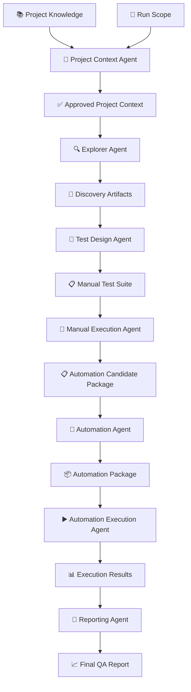
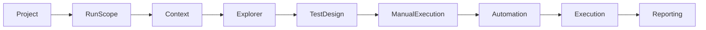
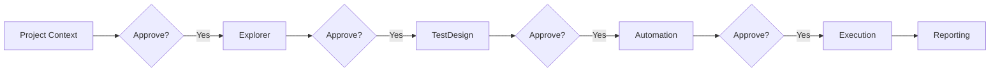
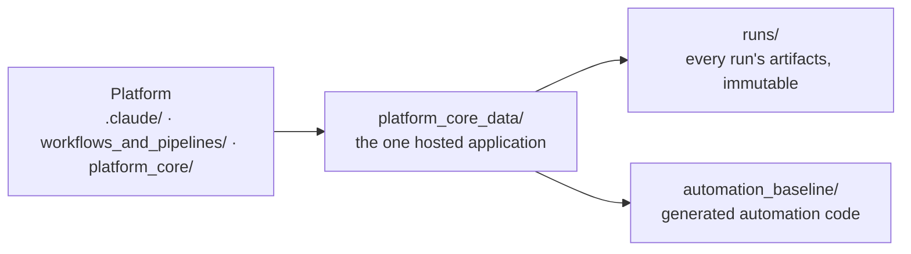
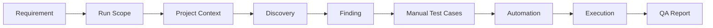

<div align="center">

# 🚀 Agentic AI Testing Platform

### Enterprise-Ready AI-Powered Software Testing Platform

**Explore • Design • Automate • Execute • Report**

<p>


</p>

</div>

---

> ## ⚠️ This is an archived overview
>
> **This document describes the pre-2.0 architecture, in which projects were hosted *inside* the platform under `projects/`.** That model no longer exists — the platform is now installed **into** the repository it tests. Sections below that reference `projects/<name>/`, `*-agent` skill names, `platform_core/knowledge/`, `workspace/`, or **Multi-Project support** are historical. The platform hosts exactly one application at a time; you retarget it by running `init` in another repository, never by adding a second project directory.
>
> It is retained for the additional narrative detail it carries. For anything current, use:
>
> | Document | What it covers |
> |---|---|
> | [`../README.md`](../README.md) | the current architectural reference — the primary entry point |
> | [`USER_GUIDE.md`](USER_GUIDE.md) | how to actually install and run the platform today |
> | [`BRANCH_MODEL.md`](BRANCH_MODEL.md) | the two long-lived branches — `tool-development` (the product) and `platform-testing` (product + dogfooding data), and how a change is promoted between them |
> | [`BRANCH_COMPARISON.md`](BRANCH_COMPARISON.md) | exactly what changed between that model and this one, with migration notes |
> | [`PROMPT_HISTORY.md`](PROMPT_HISTORY.md) | the decisions behind each of those changes |

---

# 📖 Overview

The **Agentic AI Testing Platform** is an enterprise-ready AI-powered software testing platform that orchestrates specialized AI agents to perform the complete software testing lifecycle.

Unlike traditional automation frameworks, this platform understands project knowledge, explores applications, generates manual test cases, creates automation, executes validations, and produces professional QA reports while keeping humans in control through approval gates.

The platform is designed to be:

- 🤖 Multi-Agent
- 📂 Multi-Project
- 👨 Human Governed
- 📈 Traceability Driven
- 🧩 Modular
- 🚀 Enterprise Ready

---

# 🎯 Vision

Build an AI-powered testing platform capable of understanding software projects, exploring applications, designing manual tests, generating maintainable automation, executing validations, and producing enterprise-grade QA reports.

---

# ✨ Why This Platform?

Traditional automation frameworks focus only on automation.

This platform manages the **entire QA lifecycle**.

| Traditional Framework | Agentic AI Testing Platform |
|----------------------|-----------------------------|
| Automation Only | Complete QA Lifecycle |
| Single Script | Multiple Specialized AI Agents |
| Manual Context | AI-Generated Project Context |
| No Traceability | End-to-End Traceability |
| Single Project | Multi-Project |
| Static | Run Scope Driven |
| Limited Reporting | Professional QA Reports |

---

# ⭐ Core Features

- 🤖 Multi-Agent Architecture
- 📂 Multi-Project Support
- 🎯 Run Scope
- 📚 Project Knowledge Management
- 🔍 Intelligent Application Exploration
- 📝 Manual Test Design
- 🤖 Automation Generation
- ▶️ Automated Execution
- 📊 QA Reporting
- 🔗 End-to-End Traceability
- 👨 Human Approval Gates
- 📦 Versioned Runs
- 🧩 Reusable Project Templates

---
# 🏗 Platform Architecture

The platform is built around specialized AI agents, each responsible for a single stage of the QA lifecycle.



---

# 🔄 End-to-End Workflow

Every execution follows the same approved workflow.



---

# 🤖 AI Agents

Each agent has a single responsibility and communicates only through approved artifacts.

| Agent | Responsibility |
|--------|----------------|
| 🧠 Project Context Agent | Builds the operational Project Context from Project Knowledge and Run Scope |
| 🔍 Explorer Agent | Explores the application and discovers findings |
| 📝 Test Design Agent | Generates manual test suites and traceability |
| 🧪 Manual Execution Agent | Executes the manual test suite and identifies Automation Candidates |
| 🤖 Automation Agent | Generates maintainable automation packages from Automation Candidates |
| ▶️ Automation Execution Agent | Executes automation and collects execution evidence |
| 📊 Reporting Agent | Produces the final QA assessment report |

---

# 🛡 Human Approval Gates

The platform keeps humans in control of critical decisions.



Nothing crosses an approval boundary automatically.

Every critical stage requires explicit human approval before proceeding.

---
# 📂 Repository Structure

The platform is organized to clearly separate reusable platform components, project knowledge, and generated artifacts.

```text
agentic-ai-testing-platform/

├── .claude/
│   └── skills/
│       ├── project-context-skill/SKILL.md
│       ├── explorer-skill/SKILL.md
│       ├── test-design-skill/SKILL.md
│       ├── manual-execution-skill/SKILL.md
│       ├── automation-skill/SKILL.md
│       ├── automation-execution-skill/SKILL.md
│       └── reporting-skill/SKILL.md
│
├── workflows_and_pipelines/
│   ├── pipeline/
│   │   ├── pipeline.md
│   │   ├── run_manager.md
│   │   └── run_scope.md
│   └── workflows/
│       ├── bug_fix_run.md
│       ├── first_run.md
│       └── user_story_run.md
│
├── platform_core_data/         (THE hosted project — one at a time, no project-name segment)
│   ├── README.md
│   ├── knowledge_base/         (shared across runs: PRD.md, run_configuration.md, stack.md,
│   │                            architecture.md, glossary.md, onboarding.md, requirements/,
│   │                            browser/, credentials/, business_rules/, lessons_learned/, patterns/)
│   ├── runs/                   (immutable per-run snapshots — every stage artifact)
│   └── automation_baseline/     (persistent generated automation code)
│
├── docs/
│   ├── README.md
│   ├── USER_GUIDE.md
│   ├── CHANGELOG.md
│   ├── LESSONS_LEARNED.md
│   ├── PROMPT_HISTORY.md
│   ├── BRANCH_COMPARISON.md
│   ├── PLATFORM_VALIDATION_REPORT.md
│   └── SESSION_HANDOFF.md
│
└── README.md                   (stub — points here)
```

---

# 📁 Single-Project Architecture

The platform hosts exactly one application at a time, rooted at `platform_core_data/`. Everything that is *not* about that application — the pipeline specification, the seven agent skills, Platform Knowledge, and the shared tools — sits outside it and is untouched when the platform is retargeted.



The hosted project owns, and is the only place that holds:

- Project Knowledge
- Run Configuration
- Resources
- Generated Artifacts
- Execution History

Retargeting the platform at a different application means running `init` in that repository — see the root [`README.md` §17 Getting Started](../README.md) and [`USER_GUIDE.md` §10 Retargeting](USER_GUIDE.md). It never means adding a second project directory.

---

# 📚 Project Knowledge

The platform hosts one application at a time, and everything known about it lives under one root.

```text
platform_core_data/
└── knowledge_base/     (everything shared across runs)
    ├── PRD.md · PRD_UserStories.md · run_configuration.md   (Stage 1 inputs)
    ├── onboarding.md · architecture.md · glossary.md
    ├── automation_framework.md · reference_automation_project.md
    ├── stack.md                        (written by Stage 4A, durable)
    ├── INDEX.md                        (start here — maps the whole tree)
    ├── requirements/ · api/ · diagrams/
    ├── browser/ · credentials/           (Browser Driver assets; ui/screenshots/ on demand)
    ├── business_rules/ · lessons_learned/   (the two Project Knowledge categories)
    └── patterns/                       (Platform Knowledge — separate layer)
```

Project Knowledge represents the permanent understanding of an application.

It is maintained by engineers and evolves with the product.

---

# 📦 Generated Artifacts

Generated outputs never modify the original project knowledge. The hosted project is **fully self-contained**: every stage's artifacts live under `platform_core_data/runs/{{RUN_FOLDER}}/`, one folder per run, and generated automation *code* is merged into the persistent baseline at `platform_core_data/automation_baseline/{framework}/`. There is no repository-root `artifacts/` directory, no `workspace/` tree (removed 2026-07-27), and no project-name path segment.

```text
platform_core_data/

    ├── knowledge_base/         # shared across runs — inputs and knowledge, never per-run output
    │   └── PRD.md              #   a Stage 1 input, not a generated artifact

    ├── runs/                   # every stage artifact lives in its own run folder
    │   ├── run-001__2026-07-27_09-15-00__UserStory__Login/
    │   │   ├── metadata/       #   run.json · run_summary.md · RunManifest.md
    │   │   ├── context/        #   ProjectContext.md
    │   │   ├── discovery/      #   QA_Assessment_Report.md · Timeline.md · findings/
    │   │   ├── test_design/    #   TestCases_*.md/.xlsx · TraceabilityMatrix.md
    │   │   ├── manual_execution/
    │   │   ├── automation/     #   plans/manifests/reports (temporary working copy of the code)
    │   │   ├── execution/
    │   │   └── reporting/      #   Final_QA_Report.md
    │   ├── run-002__.../
    │   └── run-003__.../

    └── automation_baseline/    # generated automation CODE — outlives the run that produced it
        └── {framework}/tests_{Framework}/
```

Each run is fully isolated and versioned.

Generated artifacts include:

- Project Context
- Discovery Artifacts
- Findings
- Manual Test Suites
- Automation Packages
- Execution Results
- Final QA Reports

---

# ⚖️ Project Knowledge vs Project Context

One of the most important architectural concepts in the platform.

| Project Knowledge | Project Context |
|-------------------|-----------------|
| Permanent | Generated Per Run |
| Maintained by Engineers | Generated by AI |
| Lives under `platform_core_data/` (excluding `runs/`) | Lives under `platform_core_data/modules/{{MODULE_SLUG}}/context/` |
| Contains everything about the application | Contains only what is required for the current run |
| Changes rarely | Generated for every execution |

Project Knowledge is the **Canonical Source of Truth**.

Project Context is the **Operational Source of Truth** for a single run.

---

# 🎯 Run Scope

Every execution starts with a Run Scope.

Supported Run Scopes:

- Entire Project
- Epic
- Feature
- User Story
- Bug
- Requirement Document
- Custom Scope

Run Scope determines exactly what the current execution is allowed to validate.

Future integrations include:

- Azure DevOps
- Jira
- Xray
- TestRail

---
# 🔗 End-to-End Traceability

One of the platform's core principles is maintaining complete traceability throughout the QA lifecycle.



Every generated artifact can be traced back to its originating requirement or scope.

---

# 📊 Generated Deliverables

The platform automatically produces a comprehensive set of artifacts during each run.

| Stage | Generated Deliverables |
|--------|------------------------|
| Project Context | Approved Project Context |
| Explorer | Discovery Report, Findings, Evidence |
| Test Design | Manual Test Suite, Traceability Matrix, Coverage Report |
| Automation | Automation Package, Automation Manifest, Decision Report |
| Execution | Execution Results, Screenshots, Videos, Traces |
| Reporting | Final QA Report |

---

# 🛡 Human Approval Philosophy

The platform is **AI-Assisted**, not AI-Autonomous.

Critical decisions always require human approval.

Approval checkpoints exist before:

- ✅ Project Context
- ✅ QA Assessment
- ✅ Automation Generation
- ✅ Test Execution (optional execution configuration)

This ensures engineers remain in full control of the testing lifecycle.

---

# 🧪 Supported Frameworks

### Currently Supported

| Framework | Status |
|------------|--------|
| Playwright | ✅ |
| SHAFT Engine | ✅ |

### Planned

| Framework | Status |
|------------|--------|
| Selenium | 🚧 |
| Cypress | 🚧 |

---

# 🚀 Quick Start

Install the platform into the repository you want to test — you do not clone it into place:

```bash
cd /path/to/your-project

npx agentic-testing init
```

Full walkthrough, including prerequisites and what `init` changes: [`USER_GUIDE.md`](USER_GUIDE.md).

## Retarget the Platform

Retargeting means running `init` in a different repository. If instead you are reusing an installation in place, clearing `platform_core_data/runs/` is your decision — and clear the Active Run pointer with it, or the next stage stops on a pointer naming a run that no longer exists:

```bash
node platform_core/tools/run_manager/cli.js clear
```

Then:

1. Populate `platform_core_data/knowledge_base/` — `PRD.md` at minimum; Stage 1 halts without it.
2. Configure the Run Scope (`workflows_and_pipelines/pipeline/run_scope.md`).
3. Create and activate a run: `node platform_core/tools/run_manager/cli.js new --scope <Scope> --target <Target>`.
4. Generate the Project Context with `/project-context-skill`.
5. Approve the generated context at its checkpoint.
6. Run the remaining pipeline stages in order.
7. Review the generated Final QA Report.

---

# 📚 Documentation

| Document | Description |
|----------|-------------|
| docs/README.md | Platform Overview (this document) |
| docs/CHANGELOG.md | Agent specification revision history |
| docs/LESSONS_LEARNED.md | Architecture Decisions |
| docs/PLATFORM_VALIDATION_REPORT.md | End-to-End Validation |
| .claude/skills/ | Agent Specifications (as Skills) |
| workflows_and_pipelines/pipeline/ | Pipeline Architecture |
| platform_core_data/ | Project Knowledge and every generated artifact |
| workflows_and_pipelines/workflows/ | Execution Workflows |

---

# 🗺 Roadmap

## ✅ Version 1.0

- Multi-Agent Architecture
- Multi-Project Support
- Project Knowledge
- Run Scope
- End-to-End Validation
- Playwright Support
- SHAFT Engine Support
- Human Approval Gates
- Versioned Runs

---

## 🚧 Version 1.1

- Project Bootstrap Wizard
- Azure DevOps Integration
- Jira Integration
- Story-Based Execution
- HTML Dashboard
- Rich Reporting

---

## 🚀 Version 2.0

- AI QA Engineer
- Self-Healing Automation
- Autonomous Test Planning
- Smart Selector Recovery
- Enterprise Dashboard

---

# 🤝 Contributing

Contributions are welcome.

Please follow these guidelines:

- Preserve the platform architecture.
- Keep agents single-responsibility.
- Maintain end-to-end traceability.
- Never bypass approval gates.
- Update documentation when introducing architectural changes.
- Prefer reuse over duplication.

---

