# User Guide

**Agentic AI Testing Platform — install it into your repository, run seven governed stages, get a traceable QA report.**

This guide is the task-oriented companion to [`README.md`](../README.md). The README explains *what the platform is and why it's built this way*; this guide walks you through *doing things with it*, in the order you'll actually need them.

| If you want to… | Go to |
|---|---|
| Get it into your project in under five minutes | [§1 Install](#1-install) |
| Understand what `init` touched in your repo | [§2 What Install Changes](#2-what-install-changes) |
| Fill in the inputs the pipeline needs | [§3 Prepare Your Inputs](#3-prepare-your-inputs) |
| Set up live browser access and MCP servers | [§4 Browser and MCP Setup](#4-browser-and-mcp-setup) |
| Run the pipeline end to end | [§5 Run the Pipeline](#5-run-the-pipeline) |
| Run one stage on its own, out of order | [§6 Calling a Single Skill Directly](#6-calling-a-single-skill-directly) |
| Know where every generated file lands | [§7 Where Your Artifacts Live](#7-where-your-artifacts-live) |
| Use a shorter, narrower run | [§8 Named Workflows](#8-named-workflows) |
| Understand the approval gates | [§9 Approvals and Gates](#9-approvals-and-gates) |
| Point the platform at a different application | [§10 Retargeting](#10-retargeting) |
| Fix something that isn't working | [§11 Troubleshooting](#11-troubleshooting) |
| Look up a CLI flag | [§12 CLI Reference](#12-cli-reference) |

---

## 1. Install

You install this platform **into** the repository you want to test. You never copy your project into the platform.

### Prerequisites

- Node.js **≥ 18.17**
- Claude Code (the skills are Claude Code skills)
- git, if you want the tool folder version-controlled (the default)

### Option A — npm (nothing to clone)

```bash
cd /path/to/your-project
npx agentic-testing init
```

### Option B — git clone (offline, or you want the source)

```bash
git clone https://github.com/ayman2911/agentic-ai-testing-platform.git
./agentic-ai-testing-platform/scripts/init.sh /path/to/your-project

# Windows
.\agentic-ai-testing-platform\scripts\init.ps1 C:\path\to\your-project
```

Both routes invoke the same `bin/agentic-testing.js`, so they produce identical results — a `prepack` check ([`scripts/verifyPackable.js`](../scripts/verifyPackable.js)) enforces that the npm tarball and the clone stay in sync.

### Look before you leap

`init` is a **plan-then-apply** installer. Nothing is written until you confirm:

```bash
npx agentic-testing detect      # read-only: what does the platform make of my project?
npx agentic-testing init --dry-run   # print the full plan, write nothing
```

`detect` reports the stack it found (from `package.json`, `pom.xml`, `requirements.txt`, and friends), the test directories it identified, and the coding conventions it will match when generating automation. If it guesses wrong, override it with `--test-dir` and `--framework` rather than letting the pipeline discover the mistake at Stage 5.

### Greenfield projects

A brand-new project with no test suite works too. With nothing to detect, the platform scaffolds test **infrastructure** only — the test directory, the framework config, and one example smoke test. It never scaffolds your application code.

---

## 2. What Install Changes

Deliberately small. After `init`, your repository looks like this:

```text
your-project/
  src/                          ← untouched
  tests/e2e/                    ← generated automation lands HERE, in your conventions
  agentic-testing-tool/         ← the platform; gitignored, with its own nested git repo
    platform_core/                 the shared tools
    platform_core_data/            every process artifact: knowledge_base/ (PRD, config), runs/,
                                   automation_baseline/
    workflows_and_pipelines/       the pipeline specification
    platform.config.json           the two-root wiring
  .claude/skills/               ← the seven skills, so Claude Code can find them
  .gitignore                    ← one marker block added
  .mcp.json                     ← two server entries added (merged, never overwritten)
```

The complete list of what `init` touches:

| Change | Detail |
|---|---|
| Adds `agentic-testing-tool/` | one folder, gitignored by default, holding the entire platform |
| Adds a marker block to `.gitignore` | delimited by markers so `upgrade` can update it without eating your rules |
| Merges two entries into `.mcp.json` | `playwright` and `context7`; your existing servers are preserved |
| Adds `.claude/skills/` | the seven `SKILL.md` files |
| Writes `platform.config.json` | inside the tool folder — the Tool Root / Target Root contract |

**What it never does:** modify your source, your CI configuration, your lockfiles, or your existing tests — and it never commits anything to your repository ([`pipeline.md` §13](../workflows_and_pipelines/pipeline/pipeline.md)). Host-file edits are *additive merges*, not overwrites.

### The two roots

Everything hinges on one distinction ([`platform_core/tools/platform_paths/README.md`](../platform_core/tools/platform_paths/README.md)):

| Root | What it is | Platform access |
|---|---|---|
| **Tool Root** | `agentic-testing-tool/` | read + write, unrestricted |
| **Target Root** | your repository | read for **technical facts only**; write **only** inside the configured automation directory |

Process artifacts always live under the Tool Root. Your project receives generated automation code and nothing else. The write allowlist is **fail-closed**: if it's empty, the platform writes nothing to your repo at all and Stage 5 generates inside `platform_core_data/` instead.

Verify the wiring any time:

```bash
npx agentic-testing doctor       # resolved roots + an ordered trace of every decision
```

---

## 3. Prepare Your Inputs

`init` scaffolds blank input documents under `agentic-testing-tool/platform_core_data/knowledge_base/` — the single home for everything shared across runs. Fill them in this order:

| # | File | What it holds | Required by |
|---|---|---|---|
| 1 | `PRD.md` | the approved requirements — **the only document Stage 1 ever reads** | Stage 1 |
| 2 | `run_configuration.md` | target URL, environment, credentials location, in-scope modules | Stage 1 |
| 3 | `architecture.md` | architecture of the application under test | optional context |
| 4 | `glossary.md` | domain terminology | optional context |
| — | `stack.md` | detected framework + pinned dependency versions | **written for you** by Stage 5 — edit only to correct it |

They ship **blank rather than pre-filled** on purpose: Stage 1 reads the PRD as approved truth and cannot tell a real requirement from a plausible-looking placeholder.

Supporting material goes under `platform_core_data/knowledge_base/` alongside the inputs — `requirements/` organized by type (`epics/`, `features/`, `user_stories/`, `bugs/`, `specifications/`), plus `api/{swagger,postman}/` and `diagrams/`.

> **Only Stage 1 reads the PRD.** Once the Project Context is approved, every downstream stage treats *that* — not the requirements document — as the source of truth for what the product should do. If the PRD changes, you re-run Stage 1; you don't hand the PRD to Stage 3.

---

## 4. Browser and MCP Setup

Skip this section if your target has no live browser to explore.

### 4.1 Browser Driver (authenticated flows)

The Browser Driver is the scripted, credential-aware engine. Set it up per [`platform_core/tools/browser_driver/README.md`](../platform_core/tools/browser_driver/README.md):

1. Create `platform_core_data/knowledge_base/browser/profile.json` — login selectors plus a post-login success signal.
2. Copy `platform_core_data/knowledge_base/credentials/credentials.template.json` → `credentials.json` and fill in real values.

`credentials.json` is git-ignored by two overlapping rules. **Never commit it.** Only the template, with placeholder values, is ever committed.

Both browser mechanisms default to **headless** — with one deliberate exception: **Stage 4 (Manual Execution) runs headed**, so you can watch each test step execute against the live app in real time. That is configured, not opt-in: `browser.headlessByStage` in `platform_core_data/knowledge_base/browser/profile.json` maps `manual_execution` to `false`. Everywhere else, headed is an explicit opt-in — useful when you're debugging a locator, not something a run should depend on.

### 4.2 The two MCP servers

The repo ships a project-scoped [`.mcp.json`](../.mcp.json) registering:

| Server | Role |
|---|---|
| `playwright` | a **second, selectable browser mode** alongside the Browser Driver — interactive and agent-driven, for exploratory discovery |
| `context7` | **version-accurate documentation** for the exact stack Stage 5 generates against |

A project-scoped `.mcp.json` requires explicit approval before its servers start. Run `/mcp` (or `claude mcp`) once per machine, then:

```bash
npx playwright install chromium
export CONTEXT7_API_KEY=...     # optional, higher rate limits — never commit this
```

**Which browser mode should a stage use?** The Browser Driver stays the default for authenticated flows; Playwright MCP is for interactive exploration. The selection rule is [`platform_core/tools/mcp/README.md` §1.2](../platform_core/tools/mcp/README.md).

> **Hard rule:** a credential value is never typed into an MCP tool call — tool arguments are transcript-visible. Authenticate with `BrowserDriver.authenticate()` and hand MCP an already-authenticated session ([`mcp/README.md` §1.3](../platform_core/tools/mcp/README.md)).

### 4.3 How Context7 gets used

At Stage 5, before generating anything, the platform extracts your project's stack and **pinned dependency versions** from its manifests and lockfiles, then queries Context7 per library at those exact versions. Generated automation is written against the docs for the versions your suite actually runs on — not whatever the model remembers. The extractor is [`platform_core/tools/mcp/stack_docs/`](../platform_core/tools/mcp/stack_docs/).

---

## 5. Run the Pipeline

Seven stages, fixed order, each one gated.

### Create and activate a run first

Every stage writes into **the active run**, so a run has to exist and be active before you invoke any skill:

```bash
cd agentic-testing-tool
node platform_core/tools/run_manager/cli.js new --scope <Scope> --target <Target>
node platform_core/tools/run_manager/cli.js active     # confirm which run is active
```

`new` is the only supported way to create a run — it allocates the folder name, anchors the run to your project's current code state, writes the Run Manifest, and activates the run in one step. Never hand-create a run folder; the metadata a stage depends on would be missing.

The active-run pointer lives at `platform_core_data/runs/current_active_run.json` and is **sticky** — it stays put until you change it. It never silently falls back to "the newest run": with no pointer a stage asks which run to use, and if the pointer names a run that no longer exists the stage stops and reports rather than guessing.

```bash
node platform_core/tools/run_manager/cli.js list      # every run, newest first, active marked *
node platform_core/tools/run_manager/cli.js use <run> # switch runs (sticky)
node platform_core/tools/run_manager/cli.js clear     # remove the pointer
```

To override the active run for a single command without changing what's on disk, set `AGENTIC_TESTING_RUN_FOLDER=<run-folder-name>`.

Full verb list in [§12 CLI Reference](#12-cli-reference).

```mermaid
flowchart LR
    A["/project-context-skill"] --> B{{"Approve<br/>Project Context?"}}
    B -->|yes| C["/explorer-skill"] --> D{{"Approve<br/>Discovery?"}}
    D -->|yes| E["/test-design-skill"] --> F{{"Approve<br/>Test Design?"}}
    F -->|yes| G["/manual-execution-skill"] --> H{{"Approve<br/>Manual Execution?"}}
    H -->|yes| I["/automation-skill"] --> J{{"⛔ Approve<br/>Automation?"}}
    J -->|yes| K["/automation-execution-skill"] --> L["/reporting-skill"] --> M["Final QA Report"]
```



| Stage | Skill | Produces |
|---|---|---|
| 1 | [`/project-context-skill`](../.claude/skills/project-context-skill/SKILL.md) | Project Context |
| 2 | [`/explorer-skill`](../.claude/skills/explorer-skill/SKILL.md) | Discovery Artifacts, Findings, Evidence |
| 3 | [`/test-design-skill`](../.claude/skills/test-design-skill/SKILL.md) | Manual Test Suite (MD + Excel), Traceability Matrix, Coverage Report |
| 4 | [`/manual-execution-skill`](../.claude/skills/manual-execution-skill/SKILL.md) | Manual Execution Results, Automation Candidate Package |
| 5 | [`/automation-skill`](../.claude/skills/automation-skill/SKILL.md) | Automation Package |
| 6 | [`/automation-execution-skill`](../.claude/skills/automation-execution-skill/SKILL.md) | Execution Results, Evidence |
| 7 | [`/reporting-skill`](../.claude/skills/reporting-skill/SKILL.md) | Final QA Report |

### Your first run

Start narrow. Run [`workflows_and_pipelines/workflows/first_run.md`](../workflows_and_pipelines/workflows/first_run.md) — Stages 1–3 only, against a single module. It proves the machinery works end to end in minutes.

It is explicitly **not** a QA sign-off on your application. It's a smoke test of the platform.

### The Automation Start Decision Gate

Before Stage 5 — or before any single downstream stage is invoked for the first time — the platform reports the actual current state of every stage and asks how to proceed ([`pipeline.md` §5.4](../workflows_and_pipelines/pipeline/pipeline.md)). It never assumes you want to resume, and never assumes you want to start fresh.

---

## 6. Calling a Single Skill Directly

You are not required to walk the pipeline in order. Any skill can be invoked directly by name, with an optional instruction prompt:

```
/test-design-skill focus only on the negative cases for US-245
```

What happens depends on the state of the upstream artifact:

| Upstream state | Behavior |
|---|---|
| **Approved** | runs normally |
| **Pending Review** | the skill **asks for approval first**, and its message recommends the next skill and action to call — you are told exactly what to do next rather than left guessing |
| **Missing entirely** | runs **degraded**: it works from whatever inputs exist, explicitly lists what was missing, and marks the affected output sections as gaps |

A degraded run is always disclosed, never silent. The output artifact and the Run Manifest both record that it ran without a complete input set, so a reviewer can tell a clean run from a partial one later.

This is the escape hatch for real work — re-running just Test Design after a requirement changes, or jumping to Reporting on an existing execution — without having to fake approvals to get there.

---

## 7. Where Your Artifacts Live

Everything a run produces lives in **that run's own folder**. There is no second copy anywhere.

### Runs — where every artifact lives

`platform_core_data/runs/{{RUN_FOLDER}}/` holds the complete output of one run:

| Artifact | Path (inside the run folder) |
|---|---|
| Project Context | `context/ProjectContext.md` |
| Discovery Artifacts | `discovery/*.md` (+ `findings/`) |
| Manual Test Suite, Traceability Matrix | `test_design/` |
| Manual Execution Results, Candidate Package | `manual_execution/` |
| Automation working copy | `automation/tests_{Framework}/` |
| Execution Results | `execution/` |
| Final QA Report | `reporting/` |
| Run Metadata + Run Manifest | `metadata/run.json`, `metadata/RunManifest.md` |

**Each artifact is one file, edited in place.** Approving it flips a `status:` field in that file's own header — it does **not** produce a second "final" copy. If you ask for a refinement, the stage edits the same file you just reviewed rather than writing a `.v2` beside it. Previous states are recoverable from git.

Only `metadata/` is created up front. Every other folder appears the moment a stage actually writes its first output, so a run that stopped after Discovery has just `metadata/` and `discovery/`.

### Automation Baseline — the one thing that outlives a run

`platform_core_data/automation_baseline/{framework}/tests_{Framework}/` is the persistent home of generated automation *code*. A run generates into its own `automation/` working copy, and that gets merged into this baseline once it clears Automation Approval — so test code survives across runs while every report stays with the run that produced it.

### Run folder names

`platform_core_data/runs/run-NNN__YYYY-MM-DD_HH-mm-ss__Scope__Target/`

Folder names are self-descriptive, e.g. `run-003__2026-07-23_15-48-55__Targeted__US-245_AddCabinClassFilter`. `run-NNN` is the run's ordinal (1-based, zero-padded to three digits, one past the highest already present). The `Scope` token is the shape of the *execution* — `FullRun`, `Regression`, `Smoke`, `Sanity`, `Targeted`, `Module`, `UserStory` — and a run that executed only specific tests is always `Targeted`, never something that reads as a full run. That token is a naming label, distinct from the run's declared **Run Scope** (what the run is allowed to validate, [§8](#run-scope)). The name is generated once, deterministically, by [`platform_core/tools/run_manager/`](../platform_core/tools/run_manager/) — never hand-formatted.

### Generated automation

Automation code goes into **your** repository, in your own test directory and conventions (`tests/e2e/`, or whatever `detect` found). The authoritative copy is the Automation Baseline at `platform_core_data/automation_baseline/{framework}/tests_{Framework}/`; a run's own `automation/` folder is only ever a temporary working copy, per the Automation Asset Lifecycle ([`pipeline.md` §12](../workflows_and_pipelines/pipeline/pipeline.md)). Merges back into the baseline are three-way and hash-verified — see [`platform_core/tools/automation_lifecycle/`](../platform_core/tools/automation_lifecycle/).

### Refining a run, and code drift

A run is a record of what was concluded on a given day, so you never edit an old one to redo its work. Create a successor instead:

```bash
node platform_core/tools/run_manager/cli.js refine <prior-run> --reason "PRD updated for US-245"
```

That creates a **new** run which inherits the prior run's artifacts by reference, supersedes it, and re-anchors to your project's current code state. The prior run is left untouched. Add `--dry-run` first to see what would be inherited.

Each run records the code state of your project at the moment it was created, so you can ask what has moved since:

```bash
node platform_core/tools/run_manager/cli.js drift [--run <r>]
```

This matters when a stage reuses an earlier run's artifact: where drift reports changes, those conclusions were reached against different code and are *unverified* against what you have now. A run created before anchoring existed can be backfilled with `cli.js anchor`, but the anchor then reflects backfill time, not execution time — so drift measured from it understates real change.

---

## 8. Named Workflows

Shorter, narrower invocations composed on top of the pipeline. A workflow never adds, removes, or reorders a stage — it only selects and narrows what already exists.

| Workflow | Stages | Use it when |
|---|---|---|
| [`first_run.md`](../workflows_and_pipelines/workflows/first_run.md) | 1–3, one module | validating the platform after install or retargeting |
| [`user_story_run.md`](../workflows_and_pipelines/workflows/user_story_run.md) | 3–7, one user story | a new story needs coverage; Project Context and Discovery already exist |
| [`bug_fix_run.md`](../workflows_and_pipelines/workflows/bug_fix_run.md) | 6 → (conditional) 5 → 6 → 7 | reproducing or verifying a known bug's regression test |

### Run Scope

Every run declares what it is allowed to validate: Entire Project, Epic, Feature, User Story, Bug, Requirement Document, or Custom Scope. Full rules: [`run_scope.md`](../workflows_and_pipelines/pipeline/run_scope.md).

---

## 9. Approvals and Gates

### Two gate types, not one

| Gate | Stages | Risk being managed |
|---|---|---|
| **Human Review Required** | 1, 2, 3, 4 | a wrong *document* reaches the next stage |
| **Automation Approval Required** | 5 | *generated code executes against a real environment* — data mutation, destructive actions, credential use |

The second is treated as at least as strict as a production deployment approval, never as a lighter variant of document review. Approving a document and authorizing code to run are different risk classes and the pipeline refuses to conflate them.

Stages 6 and 7 have no gate of their own: Stage 6 is a mechanical run already authorized by Stage 5, and Stage 7 is terminal.

### What interrupts you, and what doesn't

The platform distinguishes decisions that are genuinely yours from routine engineering judgment ([`pipeline.md` §5.5](../workflows_and_pipelines/pipeline/pipeline.md)):

**Always asks you:**
- which automation framework to use
- whether to continue an existing package or start a new one
- which project or repository to target
- environment selection, when more than one exists
- any destructive or irreversible operation
- any change to the run's actual business objective

**Decides and discloses, never pauses:**
- adding security, boundary, and negative test cases during design
- marking a scenario `Deferred` when the environment can't safely run it
- risk annotations and coverage-gap documentation
- keeping an adjacent, unrequested feature out of scope

No gate ever times out into approval. Silence is not consent ([`pipeline.md` §5.3, §6 Rule 6](../workflows_and_pipelines/pipeline/pipeline.md)).

### Rejection

A rejected artifact is revised **in place** by the **same** stage, with your feedback — no `.v2` or `_final` sibling appears beside it. The Run Manifest records the rejection and its revision count, and git holds the prior state. A rejected artifact is copied aside only if you explicitly ask for it to be preserved ([`pipeline.md` §7](../workflows_and_pipelines/pipeline/pipeline.md)).

---

## 10. Retargeting

Pointing the platform at a different application means running `init` in that repository. There is no clear-and-repopulate ritual, and no second project directory.

If you reuse an installation in place, two things matter:

- **`platform_core_data/` is never overwritten** by `init` or `upgrade`, even with `--force`. It holds your PRD and every artifact produced so far. Clearing `runs/` is your decision, not the installer's — but clear the Active Run pointer too (`node platform_core/tools/run_manager/cli.js clear`), or the next stage will stop and report a pointer naming a run that no longer exists (`run_manager.md` §5.7 Rule 2).
- **`knowledge_base/patterns/` survives retargeting by design.** It is Platform Knowledge — accumulated engineering knowledge, application-agnostic. Everything else under `knowledge_base/` is Project Knowledge and belongs to the application you're leaving behind.

### The two knowledge layers

| Layer | Location | Contains |
|---|---|---|
| **Platform Knowledge** | `platform_core_data/knowledge_base/patterns/` | reusable strategies: automation, repair, diagnosis, execution, framework, reasoning, reporting |
| **Project Knowledge** | `platform_core_data/knowledge_base/business_rules/`, `lessons_learned/` | this application's own business rules and cross-run lessons — the other seven categories were removed 2026-07-27; that output stays in each run's own folder |

Every stage resolves **Platform Knowledge first, then Project Knowledge**, and merges both. Knowledge is written project-scoped by default; moving something to the Platform layer is a **Promotion**, and requires your explicit approval — asked exactly once, and not re-proposed on every subsequent run if you decline.

`patterns/` is nested inside `knowledge_base/` **structurally only**. It's a separate layer: resolved first, written to only through Promotion, and never receiving application-specific content ([`pipeline.md` §10.6](../workflows_and_pipelines/pipeline/pipeline.md)).

---

## 11. Troubleshooting

| Symptom | Cause | Fix |
|---|---|---|
| `Target Root missing in installed mode` | `platform.config.json` has no declared `targetRoot` | run `npx agentic-testing init` in the target repo — a stage never *guesses* a target root, because guessing wrong means writing into the wrong repository |
| Stage 5 generates inside `platform_core_data/` instead of your test dir | `writeAllowlist` is empty — it is **fail-closed** | add your test globs to `target.writeAllowlist` in `platform.config.json` |
| `configVersion mismatch` | tool and config are different generations | the error names whether to upgrade the platform or migrate the config; it is deliberately a hard error, never a best-effort read |
| MCP tools unavailable | project-scoped `.mcp.json` not yet approved | run `/mcp` once per machine |
| Browser opens when you expected none | Stage 4 (Manual Execution) is headed by design, or headed was explicitly opted into | Stage 4 runs headed on purpose — see `browser.headlessByStage` in `profile.json`. For any other stage, headless is the default; check `profile.json` and the `.mcp.json` `--headless` flag |
| `.env` or credentials unreadable | the built-in read denylist | working as designed. `readDenylist` **merges with**, never replaces, a non-overridable list (`.env*`, `**/credentials*.json`, `**/secrets*`, `**/*.pem`, `**/*.key`, `**/.aws/**`, `**/id_rsa*`). Secrets reach the platform only through `platform_core_data/knowledge_base/credentials/credentials.json` |
| A stage halts citing a missing input | upstream artifact absent | either produce it, or invoke the skill directly to run degraded — see [§6](#6-calling-a-single-skill-directly) |
| Machine-specific paths need overriding | shared config is committed | use `platform.config.local.json` — gitignored, shallow-merges over the base |

Start every diagnosis with:

```bash
npx agentic-testing doctor    # validates the install, prints resolved roots + decision trace
```

---

## 12. CLI Reference

```bash
npx agentic-testing <command> [flags]
```

| Command | What it does |
|---|---|
| `init` | install into a target project (plan-then-apply) |
| `detect` | read-only stack and test-layout report; writes nothing |
| `doctor` | validate an installation, print resolved roots and the decision trace |
| `roots` | print the resolved Tool Root and Target Root as JSON |
| `upgrade` | refresh tool code and skills — **never** your artifacts |
| `uninstall` | remove tool code; keeps `platform_core_data/` unless `--purge-data` |

### `init` flags

| Flag | Effect |
|---|---|
| `--dry-run` | print the full plan and exit, writing nothing |
| `--target <path>` | install into a project other than the current directory |
| `--test-dir <path>` | override the detected automation directory |
| `--framework <name>` | override the detected framework |
| `--git-mode <mode>` | `tool-repo` (default) · `host-repo` · `off` — see [`pipeline.md` §13.9](../workflows_and_pipelines/pipeline/pipeline.md) |
| `--no-mcp` | skip MCP server registration |
| `--skills <s>` | `all` (default) · `none` · a comma-separated skill list |
| `--tool-dir <name>` | name of the folder created inside your project (default `agentic-testing-tool`) |
| `--mode <m>` | `auto` (default) · `brownfield` · `greenfield` |
| `--no-context7` | register the `playwright` MCP server only |
| `--yes` | skip the confirmation prompt (required in a non-interactive shell) |

### git modes

| Mode | Behavior |
|---|---|
| `tool-repo` *(default)* | `agentic-testing-tool/` gets its own nested git repo; your `.gitignore` ignores it. Baseline merge protection always works, and **zero commits ever land in your history** |
| `host-repo` | artifacts are versioned in your repo, visible in PRs — writes restricted to paths under `platform_core_data/` |
| `off` | no git operations; merge protection is unavailable |

### `run_manager` CLI

Run from inside the tool folder. This is the CLI you use during a run:

```bash
node platform_core/tools/run_manager/cli.js <verb> [flags]
```

| Verb | What it does |
|---|---|
| `new --scope <S> --target <T> [--workflow W] [--scope-paths a,b] [--no-activate]` | create a run — name, code-state anchor, Run Manifest, activation |
| `active [--json]` | print the active run's folder name, or the whole pointer |
| `use <run-folder-or-RunID>` | switch the active run (sticky) |
| `list [--json]` | every run on disk, newest first, active marked `*` |
| `refresh` | re-cache status and stage state for the active run |
| `clear` | remove the active-run pointer |
| `refine <prior-run> [--scope S] [--target T] [--reason "…"] [--dry-run]` | create a new run inheriting from and superseding an earlier one |
| `drift [--run <r>] [--json]` | what changed in your project since a run was anchored |
| `anchor [--run <r>] [--force]` | backfill a missing code-state anchor |
| `stage "<Stage>" --status <…> [--reviewer R] [--revisions N]` | record a stage checkpoint in the Run Manifest |
| `manifest [--json]` | read the stage ledger — "where are we right now?" |
| `manifest --gap "…" --why "…"` | declare a coverage gap |
| `manifest --reuse <artifact> --from <run> [--mode Referenced\|Copied]` | record cross-run artifact reuse |

With no verb, bare flags generate a run folder name only (`--scope`, `--target`, `--started`, `--existing-dir`, `--index` / `--no-index`, `--runs-dir`, `--json`).

**Environment overrides:** `AGENTIC_TESTING_RUN_FOLDER` (active run, per-process), `AGENTIC_TESTING_TOOL_ROOT` / `AGENTIC_TESTING_TARGET_ROOT` (the two roots).

---

## Related Documents

| Document | What it covers |
|---|---|
| [`README.md`](../README.md) | architecture, pipeline specification, design principles — the reference |
| [`PROMPT_HISTORY.md`](PROMPT_HISTORY.md) | every prompt, question, and answer that shaped this branch, with impact |
| [`BRANCH_COMPARISON.md`](BRANCH_COMPARISON.md) | before/after comparison against the source branch |
| [`pipeline.md`](../workflows_and_pipelines/pipeline/pipeline.md) | the canonical pipeline specification |
| [`platform_paths/README.md`](../platform_core/tools/platform_paths/README.md) | the two-root contract, in full |
| [`run_manager.md`](../workflows_and_pipelines/pipeline/run_manager.md) | run identity, the Active Run pointer, code-state anchoring, lineage |
| [`platform_core/templates/`](../platform_core/templates/) | the output templates every stage fills — the shape of each artifact before it's written |
| [`mcp/README.md`](../platform_core/tools/mcp/README.md) | both MCP servers and their usage contract |
| [`CHANGELOG.md`](CHANGELOG.md) | specification revision history |
| [`LESSONS_LEARNED.md`](LESSONS_LEARNED.md) | architectural lessons from past redesigns |
