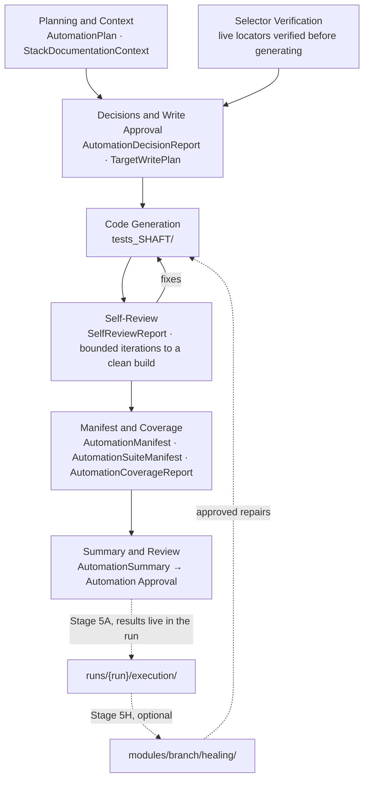

# Branch — Stage 4A Automation Engineering

> **Artifact Type:** Navigation Index
> **Stage:** Stage 4A — Automation Engineering
> **Generated By:** Hand-authored navigation layer (not a Stage 4A generated artifact)
> **Primary Consumer:** Anyone opening this folder — human or agent
> **Lifecycle:** Update when an artifact is added, or when the module's automation state changes
> **Required Gate:** None — orientation only
> **Status:** Current as of 2026-08-07

This folder is the **Stage 4A output for the `branch` module**: one standalone SHAFT Engine test
project, plus the governance record explaining how it was decided, approved, verified, and reviewed.

**This README does not restate any figure.** Every number, decision, and piece of evidence lives in
the artifact that owns it; where this page and an artifact disagree, **the artifact wins**.

## Documentation vs. executable code

| | `automation/*.md` (this folder) | [`tests_SHAFT/`](tests_SHAFT/) |
|---|---|---|
| What it is | Governance, verification, and reporting record | The **runnable Maven/TestNG project** |
| Runs? | No — nothing here executes | Yes — `mvn test` |
| Written by | Stage 4A (`automation-skill`) | Stage 4A, repaired by Stage 5H |
| Changed by | A new Stage 4A revision | Stage 4A regeneration or an approved Stage 5H repair |
| Read it to | Understand *why* the suite looks the way it does | Run, debug, or extend the suite |

Execution **results** are deliberately not stored here — they belong to the run that produced them
([`module_architecture.md` §9](../../../../workflows_and_pipelines/pipeline/module_architecture.md)).
See [Current status](#current-status) for where the latest ones are.

## Artifact map

Values below are read from the artifacts themselves. All ten artifacts carry a **Revision 1**
(run-002, US 8605 Create Branch) and a **Revision 2** (run-003, US 8599 Search & Actions + US 8606
Update Branch) section; Revision 2 is the current state.

| Phase | Artifact | Purpose | Primary Consumer | Type | Status |
|---|---|---|---|---|---|
| 1 · Planning | [AutomationPlan_SHAFT.md](AutomationPlan_SHAFT.md) | Framework, language, architecture, scope source, and risks — the plan reviewed before any code exists | Reviewer / approver | Planning input + approval record | Rev 2 · own header reads `Pending Review` |
| 1 · Planning | [StackDocumentationContext_SHAFT.md](StackDocumentationContext_SHAFT.md) | Detected stack, pinned dependency versions, and how each was confirmed | Automation agent, reviewer | Planning input (verification of stack facts) | Rev 2 · current |
| 2 · Decisions | [AutomationDecisionReport_SHAFT.md](AutomationDecisionReport_SHAFT.md) | Per-test-case decision: Generate New / Reuse / Partial / Manual Only, with reasoning | Reviewer, Test Design owner | Governance record | Rev 2 · current |
| 2 · Write approval | [TargetWritePlan_SHAFT.md](TargetWritePlan_SHAFT.md) | The exact `CREATE`/`MODIFY` list and destination, approved **before** any file was written; records the one deviation from it | Human approver | Approval gate record | Rev 2 · approved 2026-08-04 |
| 3 · Code | [tests_SHAFT/](tests_SHAFT/) · [its README](tests_SHAFT/README.md) | The generated suite itself | Anyone executing or maintaining it | Executable project | See `.module_automation_state.json` |
| 4 · Verification | [SelectorVerificationReport_SHAFT.md](SelectorVerificationReport_SHAFT.md) | Every locator, verified live against the target build, with fallback chains, evidence, and the ones deliberately left unverified | Reviewer, Stage 5H repair agent | Verification record | Rev 2 · current |
| 4 · Self-review | [SelfReviewReport_SHAFT.md](SelfReviewReport_SHAFT.md) | Each self-review iteration: what was checked, what was found, what was fixed, and what was left as follow-up | Reviewer | Verification record | Rev 2 · current |
| 5 · Inventory | [AutomationManifest_SHAFT.md](AutomationManifest_SHAFT.md) | File-by-file inventory: type, origin, which test case each file serves, build verification | Reviewer, lifecycle/merge tooling | Generated report | Rev 2 · current |
| 5 · Inventory | [AutomationSuiteManifest_SHAFT.md](AutomationSuiteManifest_SHAFT.md) | Suite-level view: business workflow per suite, execution order, data preconditions, expected outcomes | Stage 5A execution | Generated report | Rev 2 · current |
| 5 · Coverage | [AutomationCoverageReport_SHAFT.md](AutomationCoverageReport_SHAFT.md) | Automation **decision** coverage against the gated scope, coverage by user story, finding coverage, and the denominator caveat. Not implementation or execution coverage — see [what 100% means](#what-100-coverage-does-and-does-not-mean) | QA lead, stakeholder | Generated report | Rev 2 · current |
| 6 · Summary | [AutomationSummary_SHAFT.md](AutomationSummary_SHAFT.md) | The stakeholder-facing wrap-up: what was built, framework used, coverage, risks, records created | Approver, stakeholder | Final status report | Rev 2 · own header reads `Pending Review` |
| — | `.module_automation_state.json` | Machine-readable lifecycle state and its full history — the authority on module automation state | `platform_core/tools/module_manager` | State record (not a document) | `Executed` |

## Where should I start?

**I only want the final result** → [AutomationSummary_SHAFT.md](AutomationSummary_SHAFT.md), then
[AutomationCoverageReport_SHAFT.md](AutomationCoverageReport_SHAFT.md) for the coverage numbers and
their caveat. For how it actually behaved when run, see [Current status](#current-status).

**I'm reviewing automation quality** → [AutomationPlan_SHAFT.md](AutomationPlan_SHAFT.md) (was the
approach right?) → [AutomationDecisionReport_SHAFT.md](AutomationDecisionReport_SHAFT.md) (was every
case handled?) → [SelectorVerificationReport_SHAFT.md](SelectorVerificationReport_SHAFT.md) (are the
locators real and evidenced?) → [SelfReviewReport_SHAFT.md](SelfReviewReport_SHAFT.md) (what did the
generator catch itself, and what did it knowingly leave?) →
[TargetWritePlan_SHAFT.md](TargetWritePlan_SHAFT.md) (did it write only what was approved?).

**I want to execute the suite** → [tests_SHAFT/README.md](tests_SHAFT/README.md) for prerequisites
and commands, then [AutomationSuiteManifest_SHAFT.md](AutomationSuiteManifest_SHAFT.md) for suite
composition, data preconditions, and the failures that are **expected by design**.

**I'm an agent continuing or regenerating this automation** → read
[AutomationPlan_SHAFT.md](AutomationPlan_SHAFT.md) and
[StackDocumentationContext_SHAFT.md](StackDocumentationContext_SHAFT.md) for the frozen decisions
(framework, version, layout), [SelectorVerificationReport_SHAFT.md](SelectorVerificationReport_SHAFT.md)
before writing a single locator, and [AutomationManifest_SHAFT.md](AutomationManifest_SHAFT.md) for
what already exists. Scope comes from
[`../test_design/TestCases_Branch.md`](../test_design/TestCases_Branch.md), narrowed to
`Review = Approved AND Automation = Approved` — never from this folder. The stage contract is
[`.claude/skills/automation-skill/SKILL.md`](../../../../.claude/skills/automation-skill/SKILL.md).

**I'm investigating a decision or a past repair** → [AutomationDecisionReport_SHAFT.md](AutomationDecisionReport_SHAFT.md)
and [TargetWritePlan_SHAFT.md](TargetWritePlan_SHAFT.md) for the "why" of the original code; then
[`../healing/RepairSummary.md`](../healing/RepairSummary.md) and
[`../healing/BeforeAfterComparison.md`](../healing/BeforeAfterComparison.md) for every Stage 5H
repair applied to it afterwards.

## Lifecycle

Two details the generic shape hides, both taken from the artifacts: **selector verification runs
before generation**, not after (rev 1 verified its locators during the same run's Stage 4M pass,
hours before generating), and **self-review loops back into the code** until the build converges —
it is not a one-way reporting step. Dotted edges leave Stage 4A: execution and healing are separate
stages and their outputs are not stored in this folder.

## Current status

| Fact | Value | Source |
|---|---|---|
| Module automation lifecycle state | `Executed` | `.module_automation_state.json` |
| Stage 4A registry status | `Approved` — 2026-08-05, by ahmed.ayman@tildetech.ae | [`../module.json`](../module.json) |
| Assembled into the baseline | **Contested — do not rely on either value alone.** `.module_automation_state.json` records `assembledAt: null`, `baselineRef: null`; git commit `eedfaa2` (2026-08-05 13:43) is an "Automation Merge … approved in run-003" that added 46 files to `automation_baseline/shaft/tests_SHAFT/`. The baseline copy exists and is **pre-realignment, pre-healing** (its `pom.xml` still pins `9.4.20251220` under the older `shaft.version` property, and it retains the four stale Allure listener service files the module project removed). `AutomationPackages.md` also still says "never merged". | `.module_automation_state.json`; `git log -- platform_core_data/automation_baseline/shaft/tests_SHAFT/pom.xml`; [`../../../automation_baseline/AutomationPackages.md`](../../../automation_baseline/AutomationPackages.md) |
| Latest execution | `EXEC-BR-20260806-03`, 2026-08-06 | [`ExecutionResults.rerun-5.md`](../../../runs/run-003__2026-08-04_11-24-38__UserStory__US-8599-SearchActions_US-8606-UpdateBranch/execution/ExecutionResults.rerun-5.md) |
| Suite code state at that execution | Post-healing, **`Pending Automation Approval`** — REPAIR-BR-001…008 applied but not approved, not merged | same |
| Effective SHAFT version | `7.4.20231015` — resolved and executed | `pom.xml:26`; `mvn -o dependency:tree`; execution banner "Powered by SHAFT v.7.4.20231015" |

Four facts a reader should not be surprised by, each recorded somewhere other than the artifact you
might expect it in:

- **The pinned SHAFT version changed after Revision 2 was written.** `pom.xml:26` pins
  `7.4.20231015`; [StackDocumentationContext_SHAFT.md](StackDocumentationContext_SHAFT.md) Revision 2
  (2026-08-04) still records `9.4.20251220` as unchanged, as do
  [`../../../knowledge_base/stack.md`](../../../knowledge_base/stack.md) and
  [`../../../knowledge_base/automation_framework.md`](../../../knowledge_base/automation_framework.md).
  The realignment happened 2026-08-05 and is documented in
  [AutomationSummary_SHAFT.md](AutomationSummary_SHAFT.md) §3 "Version realignment". The Summary is
  correct for the current project; every `9.4.20251220` reference is historical or belongs to the
  separate baseline copy.
- **`testng.xml`'s `BranchActionsSuite` names a class that has never existed.**
  `AdminPages.Admin.Branch.BranchActions_TC` is absent from the working tree, from `target/`, and
  from every branch and commit in this repository — yet
  [AutomationManifest_SHAFT.md](AutomationManifest_SHAFT.md) line 103 inventories it as a delivered
  file carrying "3 tests", and [TargetWritePlan_SHAFT.md](TargetWritePlan_SHAFT.md) line 73 approved
  it as a `CREATE`. The file was approved and inventoried but never written — a Stage 4A generation
  defect, logged as KL-02 and explicitly left out of scope by the Stage 5H pass
  ([`../healing/RepairSummary.md`](../healing/RepairSummary.md)).
- **Three test cases are therefore unimplemented:** TC-BR-056, TC-BR-057, TC-BR-058 (Approve/Reject
  from the results grid, and their Remarks entry). All three are `Review = Approved` and
  `Automation = Approved` in [`../test_design/TestCases_Branch.md`](../test_design/TestCases_Branch.md).
  Approve/Reject has **never executed in any cycle** — it is Not Executed, not passing.
- **`32/32` in the Coverage Report means automation *decision* coverage, not implementation and not
  execution.** See below.

## What "100% coverage" does and does not mean

[AutomationCoverageReport_SHAFT.md](AutomationCoverageReport_SHAFT.md) reports **100% (32/32)**. Its
own stated basis is the decision gate — cases that received a Generate New / Reuse decision, out of
the cases where `Review = Approved AND Automation = Approved`. Measured against the executable
project, the figures diverge:

| Meaning of "coverage" | Value | Evidence |
|---|---|---|
| Automation **decision** coverage — a decision was recorded | 32 / 32 (100%) | `AutomationCoverageReport_SHAFT.md` rev 2 |
| **Implementation** coverage — an executable `@Test` exists | 29 / 32 (91%) | 13 + 11 + 5 `@Test` methods in the three `_TC` classes; TC-BR-056/057/058 have none |
| **Discovery** coverage — reachable by the executed suite file | 29 / 32 | `testng-fullcycle.xml`, which omits `BranchActionsSuite` by design |
| **Execution** coverage — actually ran in the latest cycle | 29 / 32 | `ExecutionResults.rerun-5.md` §1: `Tests run: 29` |
| **Passing** behavioural coverage | 15 / 32 (47%) | same: 15 Passed, 14 Failed, 0 skipped |

The Coverage Report's own closing caveat already narrows the denominator (32 of 81 designed cases are
automated at all). This table narrows the *numerator*: **`32/32` is not evidence that 32 tests exist,
and it is not evidence that any of them ran.** The report's rev 2 sentence "Every one of the 32
dual-approved cases has an Automation Script" is not true of TC-BR-056/057/058; it is left in place
as the historical record of what that revision claimed, and corrected here rather than overwritten.

**Read the status fields carefully — they are not all the same thing.** `AutomationPlan` and
`AutomationSummary` still record `Status: Pending Review` in their Revision 2 headers, written
2026-08-04. The module registry then recorded Stage 4A `Approved` on 2026-08-05. Stage 5H repairs
landed on the code afterwards, so the *current* code state is pending approval again. Those
statements are consistent, not contradictory: the artifacts describe the revision that was approved;
the registry and the execution results describe what has happened to the code since. The artifact
headers are left untouched deliberately — a revision's recorded status is part of its history.

## Why the files are not grouped into subfolders

They stay flat, and this README is the navigation layer instead. Grouping them under
`planning/`, `verification/`, and `reporting/` would look tidier but would break the stage:

- [`module_architecture.md` §5.1](../../../../workflows_and_pipelines/pipeline/module_architecture.md)
  specifies this folder's layout as flat, with `tests_{Framework}/` as the only subdirectory.
- [`automation-skill/SKILL.md`](../../../../.claude/skills/automation-skill/SKILL.md) hardcodes an
  absolute output path per artifact —
  `platform_core_data/modules/{{MODULE_SLUG}}/automation/AutomationPlan_{Framework}.md` and nine
  siblings. A regeneration would write to the flat path regardless of where the files had been
  moved, silently producing a second copy of every artifact.
- The same flat paths are cited from `module.json`, the run manifests, the healing artifacts, and
  the execution results. Moving files would strand those citations without improving anything a
  reader can't get from the map above.

The reorganization was evaluated and rejected on those grounds. If the layout ever should change,
the change belongs in `module_architecture.md` §5.1 and `automation-skill/SKILL.md` **first**, and
the files follow — not the other way round.
